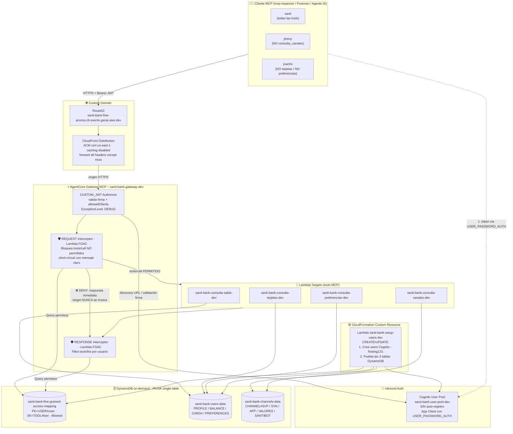
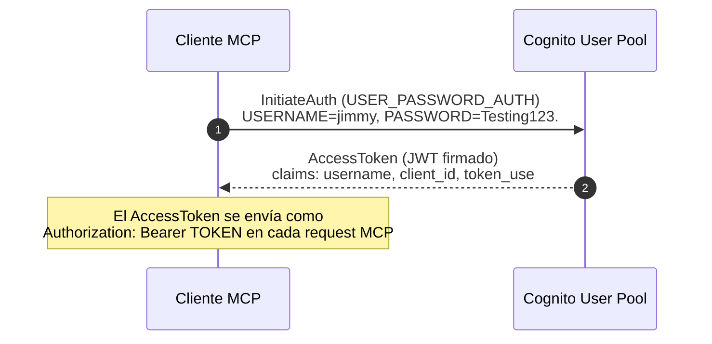
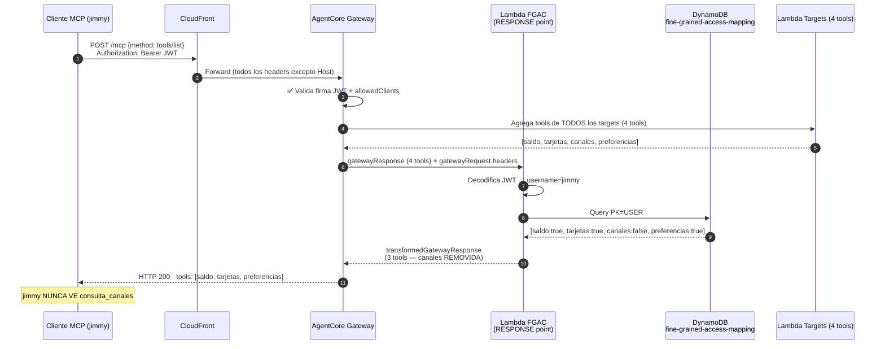
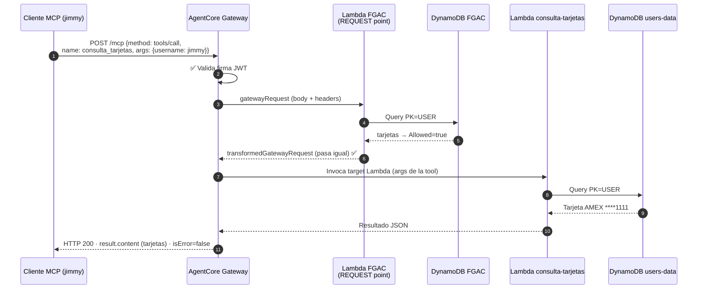
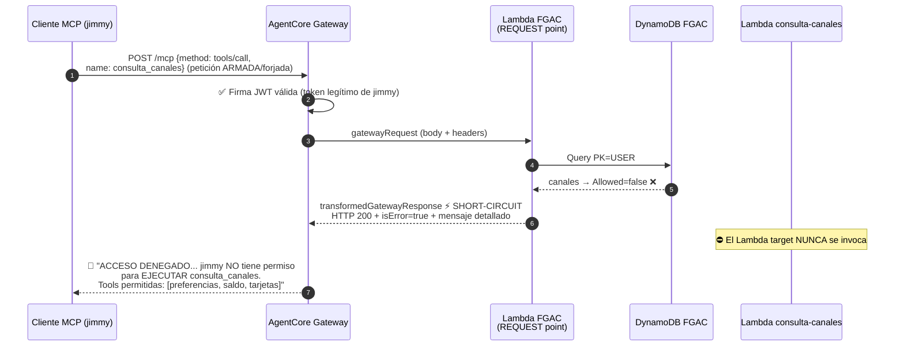
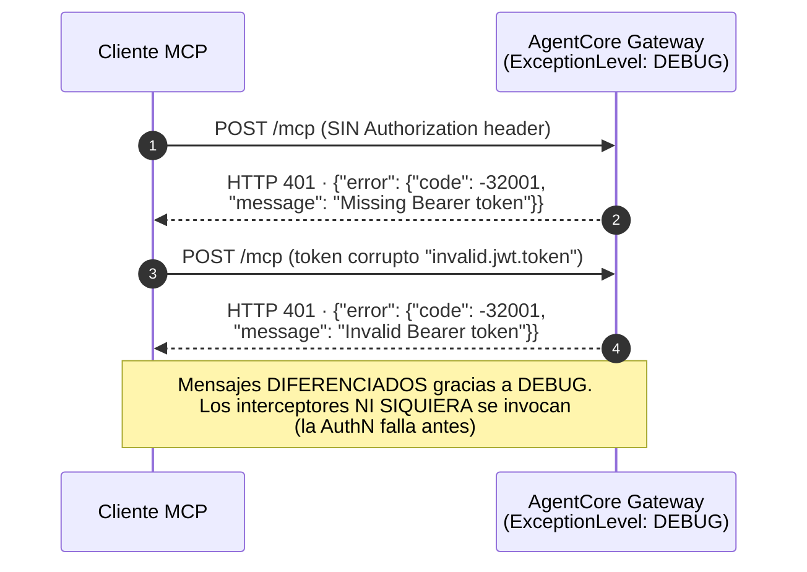

# santi-bank :: AgentCore Gateway Fine-Grained Access Control (FGAC) Demo 🏦🛡️

Replica **end-to-end** del escenario del cliente **"santi-bank"** para validar **Fine-Grained Access Control (FGAC)** sobre un **Amazon Bedrock AgentCore Gateway (MCP)**, usando:

- **Gateway Lambda Interceptors** en los DOS puntos de intercepción (**REQUEST** + **RESPONSE**).
- **Amazon DynamoDB** como *data store* dinámico de permisos (usuario → tool → allowed).
- **Amazon Cognito (JWT)** como *Inbound Auth* (CUSTOM_JWT authorizer).
- **Custom Domain** con Route53 + ACM + CloudFront.
- **100% Infraestructura como Código** con **AWS CDK (Python)** + Poetry.

> Basado en la documentación oficial de AWS Labs:
> [agentcore-samples :: 09-fine-grained-access-control :: 02-fine-grained-access-control-using-data-store](https://github.com/awslabs/agentcore-samples/blob/main/06-workshops/02-AgentCore-gateway/09-fine-grained-access-control/02-fine-grained-access-control-using-data-store/02-fine-grained-access-control-using-data-store.ipynb)

---

## Tabla de Contenido

1. [Contexto: las dudas del equipo](#1-contexto-las-dudas-del-equipo)
2. [Arquitectura general](#2-arquitectura-general)
3. [Flujos detallados (Mermaid)](#3-flujos-detallados-mermaid)
4. [Componentes desplegados](#4-componentes-desplegados)
5. [Modelo de datos DynamoDB](#5-modelo-de-datos-dynamodb)
6. [Interceptores: REQUEST vs RESPONSE](#6-interceptores-request-vs-response)
7. [Manejo de errores (Hipótesis 2)](#7-manejo-de-errores-hipótesis-2)
8. [Despliegue paso a paso](#8-despliegue-paso-a-paso)
9. [Cómo probarlo con MCP-Inspector](#9-cómo-probarlo-con-mcp-inspector)
10. [Cómo probarlo con Postman](#10-cómo-probarlo-con-postman)
11. [Cómo probarlo con curl / script E2E](#11-cómo-probarlo-con-curl--script-e2e)
12. [DEMOs guiadas con resultados esperados](#12-demos-guiadas-con-resultados-esperados)
13. [Resultados de la validación E2E](#13-resultados-de-la-validación-e2e-2026-07-26-)
14. [Estructura del proyecto](#14-estructura-del-proyecto)
15. [Limpieza (destroy)](#15-limpieza-destroy)
16. [Referencias](#16-referencias)
17. [LICENSE](#license)

---

## 1. Contexto: las dudas del equipo

El equipo del cliente tenía la validación AuthN/AuthZ **solo en el interceptor de RESPONSE** (filtrado del `tools/list`). El problema: cuando el usuario **invocaba** una tool (`tools/call`), la validación llegaba "muy tarde" — la tool ya se había ejecutado. Las dos hipótesis a validar:

| # | Hipótesis del equipo | ¿Validada? | Cómo se resolvió en este repo |
|---|---|---|---|
| 1 | La validación debe ocurrir en **ListTools** (Interceptor RESPONSE) **Y** en **InvokeTool** (Interceptor REQUEST) | ✅ | Un solo Lambda FGAC conectado a los 2 puntos de intercepción. El REQUEST interceptor hace **short-circuit** de invocaciones no autorizadas (el target NUNCA se invoca) |
| 2 | Los errores del Gateway son genéricos: "StatusCode ≠ 200 da SIEMPRE el mismo mensaje" (incluso con tokens vacíos) | ✅ | `ExceptionLevel: DEBUG` en el Gateway + patrón de DENY con **HTTP 200 + `isError: true`** para que el mensaje rico llegue al cliente MCP |

**¿Y la validación de headers custom?** ❌ **NO**. Headers como `X-Client-ID` son fácilmente falsificables. El ÚNICO origen de identidad confiable es el **JWT firmado**, cuya firma valida el Gateway (Inbound Auth) ANTES de invocar cualquier interceptor. El interceptor recibe el header `Authorization` gracias a `passRequestHeaders: true` y solo decodifica el payload (la firma ya está garantizada).

---

## 2. Arquitectura general



---

## 3. Flujos detallados (Mermaid)

### 3.1 Flujo de autenticación (obtener el JWT)



### 3.2 Flujo `tools/list` — filtrado por RESPONSE Interceptor (Hipótesis 1A)



### 3.3 Flujo `tools/call` PERMITIDO — REQUEST Interceptor deja pasar



### 3.4 Flujo `tools/call` DENEGADO — short-circuit ⭐ (Hipótesis 1B: "la ves pero NO la ejecutas")



### 3.5 Flujo de errores de autenticación (Hipótesis 2)



---

## 4. Componentes desplegados

| Componente | Nombre del recurso | Propósito |
|---|---|---|
| AgentCore Gateway | `santi-bank-gateway-dev` | Endpoint MCP con Inbound Auth JWT + interceptores |
| Custom Domain | `santi-bank-fine-access.cb.events.genai.aws.dev` | DNS amigable → CloudFront → Gateway |
| CloudFront | `d4te0tuscgxgn.cloudfront.net` | TLS con cert propio, forward de headers |
| Cognito User Pool | `santi-bank-user-pool-dev` | Identidad (SIN auto-registro) |
| Cognito App Client | `santi-bank-mcp-client-dev` | USER_PASSWORD_AUTH, sin secret |
| Lambda Interceptor | `santi-bank-fgac-interceptor-dev` | FGAC en REQUEST + RESPONSE |
| Lambda Tool 1 | `santi-bank-consulta-saldo-dev` | Saldo de un usuario (users-data) |
| Lambda Tool 2 | `santi-bank-consulta-tarjetas-dev` | Tarjetas crédito/débito (users-data) |
| Lambda Tool 3 | `santi-bank-consulta-canales-dev` | Estado de TODOS los canales (channels-data, scan) |
| Lambda Tool 4 | `santi-bank-consulta-preferencias-dev` | Preferencias app (users-data) |
| Lambda Setup | `santi-bank-setup-users-dev` | Custom Resource: users + seed data |
| DynamoDB 1 | `santi-bank-fine-grained-access-mapping` | Matriz de permisos (FGAC) |
| DynamoDB 2 | `santi-bank-users-data` | Datos bancarios de usuarios |
| DynamoDB 3 | `santi-bank-channels-data` | Estado de canales |

### Matriz de permisos (seed inicial)

| Usuario | consulta_saldo | consulta_tarjetas | consulta_canales | consulta_preferencias | Tools visibles |
|---|:---:|:---:|:---:|:---:|:---:|
| `santi` | ✅ | ✅ | ✅ | ✅ | **4** |
| `jimmy` | ✅ | ✅ | ❌ | ✅ | **3** |
| `joacho` | ✅ | ❌ | ✅ | ❌ | **2** |

> 🔥 **Permisos DINÁMICOS**: cambia el atributo `Allowed` (true/false) en DynamoDB y el cambio aplica **inmediatamente** (listado + ejecución), **sin redeploy**.

---

## 5. Modelo de datos DynamoDB

Las 3 tablas usan **single-table design** con `PK`/`SK` (billing **on-demand / PAY_PER_REQUEST**).

### 5.1 `santi-bank-fine-grained-access-mapping` (la tabla FGAC ⭐)

| PK | SK | Allowed | GrantedBy |
|---|---|:---:|---|
| `USER#santi` | `TOOL#consulta_saldo` | `true` | santi-bank-custom-resource |
| `USER#jimmy` | `TOOL#consulta_canales` | `false` | santi-bank-custom-resource |
| `USER#joacho` | `TOOL#consulta_tarjetas` | `false` | santi-bank-custom-resource |

- El interceptor hace `Query PK=USER#<username>` (1 sola lectura por request).
- **Ausencia del item** o `Allowed=false` ⇒ **DENY (fail-closed)**.
- Items explícitos con `false` facilitan la lectura de la matriz y el flip dinámico.

### 5.2 `santi-bank-users-data`

| PK | SK | Ejemplo de atributos |
|---|---|---|
| `USER#santi` | `PROFILE` | full_name, document, segment, email |
| `USER#santi` | `BALANCE` | available_balance: 15750000.50, currency: COP, account_type |
| `USER#santi` | `CARD#CREDIT-VISA-4321` | brand, masked_number, status, credit_limit |
| `USER#santi` | `PREFERENCES` | nickname, color_app (Blanco/Negro), tope_cajero, tope_transaccion, contacto_emergencia |

### 5.3 `santi-bank-channels-data`

| PK | SK | channel_name | status |
|---|---|---|---|
| `CHANNEL#SVP` | `STATUS` | Sucursal Virtual Personas (SVP) | OPERATIVO |
| `CHANNEL#SVN` | `STATUS` | Sucursal Virtual Negocios (SVN) | OPERATIVO |
| `CHANNEL#APP-MIBANCOAPP` | `STATUS` | MiBancoApp (App) | DEGRADADO |
| `CHANNEL#VALORES` | `STATUS` | Valores santi-bank | OPERATIVO |
| `CHANNEL#SANTIBOT` | `STATUS` | SantiBot (WhatsApp) | MANTENIMIENTO |

---

## 6. Interceptores: REQUEST vs RESPONSE

Un Gateway soporta **máximo 1 interceptor REQUEST y 1 RESPONSE**. Este repo usa **UN solo Lambda** (`santi-bank-fgac-interceptor-dev`) conectado a ambos puntos (detecta el punto por la presencia de `gatewayResponse` en el evento).

### 6.1 Comparativa de los dos puntos de intercepción

| Aspecto | REQUEST Interceptor | RESPONSE Interceptor |
|---|---|---|
| **Cuándo se ejecuta** | ANTES de invocar el target | DESPUÉS del target, antes de responder al cliente |
| **Caso de uso aquí** | Bloquear `tools/call` no autorizado (**InvokeTool**) | Filtrar `tools/list` (**ListTools**) |
| **Input clave** | `mcp.gatewayRequest` (body + headers) | `mcp.gatewayResponse` + `mcp.gatewayRequest` |
| **Output para dejar pasar** | `transformedGatewayRequest` | `transformedGatewayResponse` (igual) |
| **Output para BLOQUEAR** | `transformedGatewayResponse` ⚡ (**short-circuit**: el Gateway responde YA y el target NUNCA se invoca) | `transformedGatewayResponse` (modificada) |
| **¿Puede leer el JWT?** | Sí, con `passRequestHeaders: true` | Sí, con `passRequestHeaders: true` |

> ⚠️ **Detalle importante de la documentación**: si el REQUEST interceptor retorna `transformedGatewayResponse` (short-circuit), el RESPONSE interceptor **IGUAL se invoca** después. Por eso el handler RESPONSE hace *pass-through* de todo lo que no sea un `tools/list` (incluidos los DENY del REQUEST).

### 6.2 Comparativa: setup original del equipo vs setup recomendado (este repo)

| Aspecto | ❌ Solo RESPONSE (setup original) | ✅ REQUEST + RESPONSE (este repo) |
|---|---|---|
| Usuario ve solo sus tools | ✅ | ✅ |
| Petición ARMADA (`tools/call` forjado) | ⚠️ La tool YA se ejecutó cuando validas | 🛡️ Bloqueada ANTES de ejecutar (short-circuit) |
| Permiso revocado en caliente | ⚠️ Ejecuta hasta el próximo re-listado | 🛡️ Bloqueo inmediato en la siguiente invocación |
| "La ves pero NO la ejecutas" | ❌ Imposible | ✅ Nativo |
| Costo | 1 invocación Lambda por request | 2 invocaciones Lambda por request (REQUEST + RESPONSE) |

### 6.3 Contrato del interceptor (payloads)

**Input (REQUEST point):**

```json
{
  "interceptorInputVersion": "1.0",
  "mcp": {
    "gatewayRequest": {
      "path": "/mcp",
      "httpMethod": "POST",
      "headers": { "Authorization": "Bearer <JWT>" },
      "body": { "jsonrpc": "2.0", "id": 2, "method": "tools/call",
                "params": { "name": "consulta-canales___consulta_canales", "arguments": {} } }
    }
  }
}
```

**Output DENY (short-circuit):**

```json
{
  "interceptorOutputVersion": "1.0",
  "mcp": {
    "transformedGatewayResponse": {
      "statusCode": 200,
      "body": {
        "jsonrpc": "2.0", "id": 2,
        "result": {
          "content": [{ "type": "text", "text": "🚫 ACCESO DENEGADO por santi-bank FGAC: ..." }],
          "isError": true
        }
      }
    }
  }
}
```

---

## 7. Manejo de errores (Hipótesis 2)

### 7.1 Comparativa de estrategias de DENY

| Estrategia | Qué ve el cliente MCP | Ventaja | Desventaja |
|---|---|---|---|
| HTTP 403/500 (status ≠ 200) | ⚠️ Error de transporte **GENÉRICO** — el mensaje rico se pierde en la mayoría de clientes MCP | Semántica HTTP "correcta" | **Este era el dolor del equipo**: "StatusCode ≠ 200 da SIEMPRE el mismo mensaje" |
| ✅ **HTTP 200 + `result.isError: true`** (modo `mcp_error`, default) | Mensaje completo: usuario, tool bloqueada, tools permitidas | El **agente LLM puede LEER el motivo y reaccionar** (p.ej. usar otra tool) | Requiere que el cliente respete `isError` |
| HTTP 200 + JSON-RPC `error` (modo `jsonrpc_error`) | Error de protocolo con `code: -32003` + `data` estructurada | Estándar JSON-RPC, data parseable | Algunos clientes lo muestran como fallo de protocolo |

> El modo se cambia con la variable de entorno `DENY_MODE` del Lambda interceptor (configurable en `cdk.json` → `interceptor_deny_mode`).

### 7.2 Comparativa `ExceptionLevel` del Gateway

| Escenario | Sin `ExceptionLevel` (default) | Con `ExceptionLevel: DEBUG` (este repo) |
|---|---|---|
| Token vacío | Mensaje genérico | `HTTP 401 · "Missing Bearer token"` |
| Token inválido/corrupto | Mensaje genérico (igual al anterior) | `HTTP 401 · "Invalid Bearer token"` (¡DIFERENTE!) |
| Error interno de un target Lambda | Mensaje genérico | Detalle del error de invocación |

En CDK (1 línea):

```python
exception_level=agentcore.GatewayExceptionLevel.DEBUG,
```

---

## 8. Despliegue paso a paso

### 8.1 Prerrequisitos

| Herramienta | Versión probada | Verificar con |
|---|---|---|
| AWS CLI v2 (credenciales activas) | 2.x | `aws sts get-caller-identity` |
| AWS CDK CLI | 2.1130.0 | `cdk --version` |
| Python | 3.12 / 3.13 | `python3 --version` |
| Poetry | 2.1.3 | `poetry --version` |
| Node.js (para CDK y mcp-inspector) | 22/24 | `node --version` |
| Cuenta bootstrapeada con CDK | - | `aws cloudformation describe-stacks --stack-name CDKToolkit` |
| Hosted Zone en Route53 | `cb.events.genai.aws.dev` | ya existente (config en `cdk.json`) |

### 8.2 Pasos

```bash
# 1. Clonar / entrar al repo
cd aws-agentcore-fine-grained-access-bank-demo/infrastructure

# 2. Instalar dependencias (Poetry con .venv en el root del proyecto CDK)
poetry config virtualenvs.in-project true
poetry install

# 3. (Opcional) Revisar la configuración por ambiente
cat cdk.json   # app_config.dev: nombres de tablas, dominio, deny mode, etc.

# 4. Sintetizar (valida el template de CloudFormation)
poetry run cdk synth

# 5. Ver el diff contra lo desplegado (si aplica)
poetry run cdk diff

# 6. Desplegar TODO (~8-12 min por ACM + CloudFront)
poetry run cdk deploy --all --require-approval never

# 7. Ver outputs del stack
aws cloudformation describe-stacks --stack-name santi-bank-fine-access-dev \
  --query "Stacks[0].Outputs" --output table
```

> También hay `Makefile`: `make install`, `make synth`, `make diff`, `make deploy`, `make destroy`.

### 8.3 ¿Qué hace el despliegue automáticamente? (Custom Resource)

El Custom Resource (`santi-bank-setup-users-dev`) corre en **CREATE y UPDATE** del stack (idempotente) y deja todo listo:

| Paso | Acción |
|---|---|
| 1 | Crea usuarios Cognito `santi`, `jimmy`, `joacho` con password **permanente** `Testing123.` (sin flujo de verificación) |
| 2 | Puebla `santi-bank-users-data` (perfiles, saldos, tarjetas, preferencias) |
| 3 | Puebla `santi-bank-channels-data` (SVP, SVN, App, Valores, SantiBot) |
| 4 | Puebla `santi-bank-fine-grained-access-mapping` (matriz de permisos) |

### 8.4 Outputs del stack (valores reales del despliegue)

| Output | Valor |
|---|---|
| `CustomDomainMcpUrl` | `https://santi-bank-fine-access.cb.events.genai.aws.dev/mcp` |
| `GatewayUrl` | `https://santi-bank-gateway-dev-kiogzebcfh.gateway.bedrock-agentcore.us-east-1.amazonaws.com/mcp` |
| `CognitoUserPoolId` | `us-east-1_Z0amGv9rk` |
| `CognitoAppClientId` | `4ilvj9e26ovcv37g152tranglc` |
| `CloudFrontDomain` | `d4te0tuscgxgn.cloudfront.net` |

---

## 9. Cómo probarlo con MCP-Inspector

### 9.1 Obtener un token JWT (por usuario)

```bash
CLIENT_ID="<CognitoAppClientId del output>"

aws cognito-idp initiate-auth --region us-east-1 \
  --auth-flow USER_PASSWORD_AUTH \
  --client-id $CLIENT_ID \
  --auth-parameters USERNAME=jimmy,PASSWORD=Testing123. \
  --query "AuthenticationResult.AccessToken" --output text
```

### 9.2 Modo UI (interfaz web)

```bash
npx @modelcontextprotocol/inspector
```

| Campo | Valor |
|---|---|
| **Transport Type** | `Streamable HTTP` |
| **URL** | `https://santi-bank-fine-access.cb.events.genai.aws.dev/mcp` |
| **Authentication → Bearer Token** | El AccessToken del usuario (santi/jimmy/joacho) |

Luego: **Connect** → **List Tools** → invoca tools con `Run Tool`.

### 9.3 Modo CLI (headless, ideal para demos rápidas)

```bash
DOMAIN="https://santi-bank-fine-access.cb.events.genai.aws.dev/mcp"
TOKEN="<AccessToken>"

# Listar tools (verás el filtrado FGAC por usuario)
npx @modelcontextprotocol/inspector --cli $DOMAIN --transport http \
  --header "Authorization: Bearer $TOKEN" --method tools/list

# Invocar una tool PERMITIDA
npx @modelcontextprotocol/inspector --cli $DOMAIN --transport http \
  --header "Authorization: Bearer $TOKEN" --method tools/call \
  --tool-name "consulta-tarjetas___consulta_tarjetas" --tool-arg username=jimmy

# Invocar una tool DENEGADA (petición "armada": jimmy NO tiene canales)
npx @modelcontextprotocol/inspector --cli $DOMAIN --transport http \
  --header "Authorization: Bearer $TOKEN" --method tools/call \
  --tool-name "consulta-canales___consulta_canales"
```

> 📛 **Naming de tools**: el Gateway expone cada tool como `<target-name>___<tool_name>` (triple underscore). Ejemplo: `consulta-saldo___consulta_saldo`.

### 9.4 Resultados esperados por usuario

| Usuario | tools/list muestra | Tool bloqueada al invocar |
|---|---|---|
| `santi` | las 4 tools | ninguna |
| `jimmy` | saldo, tarjetas, preferencias (3) | `consulta_canales` 🚫 |
| `joacho` | saldo, canales (2) | `consulta_tarjetas` y `consulta_preferencias` 🚫 |

---

## 10. Cómo probarlo con Postman

### 10.1 Request 1 — Obtener el token (Cognito)

| Campo | Valor |
|---|---|
| Método | `POST` |
| URL | `https://cognito-idp.us-east-1.amazonaws.com/` |
| Header | `Content-Type: application/x-amz-json-1.1` |
| Header | `X-Amz-Target: AWSCognitoIdentityProviderService.InitiateAuth` |

**Body (raw / JSON):**

```json
{
  "AuthFlow": "USER_PASSWORD_AUTH",
  "ClientId": "4ilvj9e26ovcv37g152tranglc",
  "AuthParameters": {
    "USERNAME": "jimmy",
    "PASSWORD": "Testing123."
  }
}
```

➡️ Copia `AuthenticationResult.AccessToken` de la respuesta (guárdalo en una variable de Postman, p.ej. `{{access_token}}`).

### 10.2 Request 2 — `tools/list` (MCP)

| Campo | Valor |
|---|---|
| Método | `POST` |
| URL | `https://santi-bank-fine-access.cb.events.genai.aws.dev/mcp` |
| Header | `Content-Type: application/json` |
| Header | `Accept: application/json, text/event-stream` |
| Header | `Authorization: Bearer {{access_token}}` |

**Body (raw / JSON):**

```json
{ "jsonrpc": "2.0", "id": 1, "method": "tools/list", "params": {} }
```

✅ **Esperado (jimmy)**: HTTP 200 con SOLO 3 tools (sin `consulta_canales`).

### 10.3 Request 3 — `tools/call` permitido

Misma URL/headers. **Body:**

```json
{
  "jsonrpc": "2.0", "id": 2, "method": "tools/call",
  "params": {
    "name": "consulta-saldo___consulta_saldo",
    "arguments": { "username": "jimmy" }
  }
}
```

✅ **Esperado**: HTTP 200 · `result.content[0].text` con el saldo · `isError: false`.

### 10.4 Request 4 — `tools/call` DENEGADO (petición armada) ⭐

Misma URL/headers (token de **jimmy**). **Body:**

```json
{
  "jsonrpc": "2.0", "id": 3, "method": "tools/call",
  "params": {
    "name": "consulta-canales___consulta_canales",
    "arguments": {}
  }
}
```

✅ **Esperado**: HTTP 200 · `isError: true` · texto `🚫 ACCESO DENEGADO por santi-bank FGAC...` con la lista de tools permitidas.

### 10.5 Request 5 — Errores de token (Hipótesis 2)

| Prueba | Header Authorization | Respuesta esperada |
|---|---|---|
| Sin token | (eliminar el header) | `HTTP 401 · {"error":{"code":-32001,"message":"Missing Bearer token"}}` |
| Token corrupto | `Bearer invalid.jwt.token` | `HTTP 401 · {"error":{"code":-32001,"message":"Invalid Bearer token"}}` |
| Token expirado (>8h) | `Bearer <token viejo>` | `HTTP 401` con mensaje de expiración |

> 💡 Si la respuesta llega como `text/event-stream` (SSE), el JSON viene en la línea `data: {...}`.

---

## 11. Cómo probarlo con curl / script E2E

### 11.1 Script E2E automatizado (el mismo que validó el despliegue)

```bash
# Valida TODO: 3 usuarios x (list + call permitido + call denegado) + errores,
# contra el Gateway URL directo Y el custom domain:
python3 scripts/validate_fgac.py                # ambos endpoints
python3 scripts/validate_fgac.py --url-mode domain   # solo custom domain
```

### 11.2 curl manual

```bash
DOMAIN="https://santi-bank-fine-access.cb.events.genai.aws.dev/mcp"
TOKEN=$(aws cognito-idp initiate-auth --region us-east-1 \
  --auth-flow USER_PASSWORD_AUTH --client-id 4ilvj9e26ovcv37g152tranglc \
  --auth-parameters USERNAME=joacho,PASSWORD=Testing123. \
  --query "AuthenticationResult.AccessToken" --output text)

# tools/list (joacho -> 2 tools)
curl -s -X POST $DOMAIN \
  -H "Content-Type: application/json" \
  -H "Accept: application/json, text/event-stream" \
  -H "Authorization: Bearer $TOKEN" \
  -d '{"jsonrpc":"2.0","id":1,"method":"tools/list","params":{}}'

# tools/call DENEGADO (joacho NO tiene tarjetas)
curl -s -X POST $DOMAIN \
  -H "Content-Type: application/json" \
  -H "Accept: application/json, text/event-stream" \
  -H "Authorization: Bearer $TOKEN" \
  -d '{"jsonrpc":"2.0","id":2,"method":"tools/call","params":{"name":"consulta-tarjetas___consulta_tarjetas","arguments":{"username":"joacho"}}}'
```

---

## 12. DEMOs guiadas con resultados esperados

### DEMO 1 — Filtrado de ListTools por usuario (RESPONSE Interceptor)

| Paso | Acción | Resultado esperado |
|---|---|---|
| 1 | Token de `santi` → `tools/list` | 4 tools |
| 2 | Token de `jimmy` → `tools/list` | 3 tools (SIN `consulta_canales`) |
| 3 | Token de `joacho` → `tools/list` | 2 tools (`consulta_saldo`, `consulta_canales`) |

### DEMO 2 — "La ves pero NO la ejecutas" / petición armada (REQUEST Interceptor)

| Paso | Acción | Resultado esperado |
|---|---|---|
| 1 | Con token de `jimmy`, invocar `consulta-canales___consulta_canales` (aunque NO aparece en su listado) | 🚫 HTTP 200 + `isError: true` + mensaje detallado. **El Lambda target NUNCA se invoca** (verificable en CloudWatch: el log del interceptor muestra "Short-circuiting request!") |
| 2 | Con token de `joacho`, invocar `consulta-tarjetas___consulta_tarjetas` | 🚫 Igual: DENY con mensaje claro |

### DEMO 3 — Permisos dinámicos (sin redeploy) 🔥

| Paso | Acción | Resultado esperado |
|---|---|---|
| 1 | `aws dynamodb update-item` → `USER#jimmy / TOOL#consulta_canales` → `Allowed=true` | - |
| 2 | `tools/list` con token de jimmy | **4 tools** (aparece canales) — inmediato |
| 3 | `tools/call consulta_canales` con jimmy | ✅ Estado de los 5 canales |
| 4 | Revertir a `Allowed=false` | - |
| 5 | `tools/call consulta_canales` con jimmy | 🚫 DENY inmediato |

```bash
# Otorgar:
aws dynamodb update-item --region us-east-1 \
  --table-name santi-bank-fine-grained-access-mapping \
  --key '{"PK":{"S":"USER#jimmy"},"SK":{"S":"TOOL#consulta_canales"}}' \
  --update-expression "SET Allowed = :v" \
  --expression-attribute-values '{":v":{"BOOL":true}}'
# Revocar: igual con {"BOOL":false}
```

### DEMO 4 — Manejo de errores (Hipótesis 2)

| Prueba | Resultado esperado |
|---|---|
| Sin header Authorization | `HTTP 401 · "Missing Bearer token"` |
| Token corrupto | `HTTP 401 · "Invalid Bearer token"` (mensaje DIFERENTE al anterior) |
| Tool permitida pero username inexistente en data | HTTP 200 con error de negocio en el JSON de la tool |

### DEMO 5 — Observabilidad (LOGGING SIGNIFICATIVO)

```bash
# Ver la decisión FGAC en tiempo real (ALLOW/DENY, tools removidas, short-circuits):
aws logs tail /aws/lambda/santi-bank-fgac-interceptor-dev --region us-east-1 --follow

# Logs de las tools:
aws logs tail /aws/lambda/santi-bank-consulta-canales-dev --region us-east-1 --follow
```

Ejemplo real del log del interceptor durante un DENY:

```text
[FGAC][REQUEST] MCP method: 'tools/call' | request id: 2
[FGAC][REQUEST] tools/call requested tool: 'consulta-canales___consulta_canales' (base: 'consulta_canales')
[FGAC][DDB] ALLOWED tools for 'jimmy': ['consulta_preferencias', 'consulta_saldo', 'consulta_tarjetas']
[FGAC][REQUEST] DENY - user 'jimmy' tried to execute tool 'consulta_canales' WITHOUT permission. Short-circuiting request!
```

---

## 13. Resultados de la validación E2E (2026-07-26) ✅

Ejecutado contra el **Gateway URL directo** y el **custom domain (CloudFront)**: **20/20 PASS**.

| Validación | Resultado |
|---|:---:|
| `santi` tools/list → 4 tools | ✅ |
| `jimmy` tools/list → 3 tools (sin `consulta_canales`) | ✅ |
| `joacho` tools/list → 2 tools (sin tarjetas/preferencias) | ✅ |
| tools/call permitida (cada usuario) → data real desde DynamoDB | ✅ |
| `jimmy` tools/call FORJADA a `consulta_canales` → bloqueada por REQUEST interceptor (short-circuit) | ✅ |
| `joacho` tools/call FORJADA a `consulta_tarjetas` → bloqueada con mensaje claro | ✅ |
| Token vacío → `401 "Missing Bearer token"` | ✅ |
| Token inválido → `401 "Invalid Bearer token"` (diferenciado por ExceptionLevel DEBUG) | ✅ |
| Revocación/otorgamiento DINÁMICO vía DynamoDB (sin redeploy) | ✅ |
| mcp-inspector CLI (Streamable HTTP + Bearer) vía custom domain | ✅ |

---

## 14. Estructura del proyecto

```text
├── README.md                          # Este documento
├── LICENSE                            # Apache License 2.0
├── .gitignore
├── backend/lambdas/
│   ├── consulta_saldo/handler.py          # Tool: saldo de un usuario (users-data)
│   ├── consulta_tarjetas/handler.py       # Tool: tarjetas de un usuario (users-data)
│   ├── consulta_canales/handler.py        # Tool: estado de TODOS los canales (channels-data)
│   ├── consulta_preferencias/handler.py   # Tool: preferencias app de un usuario (users-data)
│   ├── fgac_interceptor/handler.py        # 🛡️ Interceptor FGAC (REQUEST + RESPONSE)
│   └── setup_custom_resource/handler.py   # Custom Resource: users Cognito + seed DynamoDB
├── infrastructure/
│   ├── cdk.json                       # app_config (dev): nombres, dominio, deny mode
│   ├── pyproject.toml                 # Poetry (.venv en el root del proyecto CDK)
│   ├── Makefile                       # install / synth / diff / deploy / destroy
│   ├── .gitignore
│   └── cdk/
│       ├── app.py                     # Entry point CDK (DEPLOYMENT_ENVIRONMENT)
│       ├── helpers/add_tags.py        # Tags globales (Owner, Source, Environment...)
│       └── stacks/cdk_santi_bank_stack.py  # Stack completo (métodos organizados)
└── scripts/
    └── validate_fgac.py               # Validación E2E (20 checks, stdlib + AWS CLI)
```

---

## 15. Limpieza (destroy)

```bash
cd infrastructure
poetry run cdk destroy --all --force
# o: make destroy
```

> Las tablas DynamoDB y el User Pool tienen `RemovalPolicy.DESTROY` en `dev` (se eliminan con el stack). En `prod` la convención del stack cambia a `RETAIN`.

---

## 16. Referencias

| Recurso | Link |
|---|---|
| Notebook oficial FGAC con Data Store (base de este repo) | [agentcore-samples/06-workshops/.../02-fine-grained-access-control-using-data-store.ipynb](https://github.com/awslabs/agentcore-samples/blob/main/06-workshops/02-AgentCore-gateway/09-fine-grained-access-control/02-fine-grained-access-control-using-data-store/02-fine-grained-access-control-using-data-store.ipynb) |
| Docs: Gateway Interceptors (tipos y contratos) | [docs.aws.amazon.com/bedrock-agentcore/.../gateway-interceptors-types](https://docs.aws.amazon.com/bedrock-agentcore/latest/devguide/gateway-interceptors-types.html) |
| Docs: Configuración de interceptores (`passRequestHeaders`) | [docs.aws.amazon.com/bedrock-agentcore/.../gateway-interceptors-configuration](https://docs.aws.amazon.com/bedrock-agentcore/latest/devguide/gateway-interceptors-configuration.html) |
| CDK L2: `aws_bedrockagentcore` (Gateway, LambdaInterceptor, Targets) | [docs.aws.amazon.com/cdk/api/v2/docs/aws-cdk-lib.aws_bedrockagentcore-readme](https://docs.aws.amazon.com/cdk/api/v2/docs/aws-cdk-lib.aws_bedrockagentcore-readme.html) |
| MCP Inspector | [github.com/modelcontextprotocol/inspector](https://github.com/modelcontextprotocol/inspector) |

## Usuarios demo (Cognito)

| Usuario | Password | Notas |
|---|---|---|
| `santi` | `Testing123.` | Acceso total (4 tools) |
| `jimmy` | `Testing123.` | Sin `consulta_canales` |
| `joacho` | `Testing123.` | Sin tarjetas ni preferencias |

> ⚠️ Contraseñas de DEMO (requerimiento explícito del escenario). El User Pool **NO permite auto-registro** y el App Client no tiene secret (cliente público solo para pruebas).

# LICENSE

Licensed under the **Apache License, Version 2.0** — see the [LICENSE](./LICENSE) file for details.

Copyright 2026 Santiago Garcia Arango
