# santi-bank :: AgentCore Gateway Fine-Grained Access Control (FGAC) Demo 🏦🛡️

Replica **end-to-end** del escenario del cliente **"santi-bank"** para validar **Fine-Grained Access Control (FGAC)** sobre un **Amazon Bedrock AgentCore Gateway (MCP)**, usando:

- **Gateway Lambda Interceptors** en los DOS puntos de intercepción (**REQUEST** + **RESPONSE**).
- **Amazon DynamoDB** como *data store* dinámico de permisos (usuario → tool → allowed).
- **Amazon Cognito (JWT)** como *Inbound Auth* (CUSTOM_JWT authorizer).
- **Custom Domain** con Route53 + ACM + CloudFront.
- **Origin Cloaking** 🧱: **AWS WAF asociado directamente al Gateway** + secreto aleatorio en **Secrets Manager** inyectado por CloudFront como header. El Gateway SOLO acepta tráfico que venga de CloudFront, y el WAF **solo guarda el SHA-256 del secreto** (text transformation `SHA256`), nunca el valor en claro.
- **100% Infraestructura como Código** con **AWS CDK (Python)** + Poetry.

> Basado en la documentación oficial de AWS Labs:
> [agentcore-samples :: 09-fine-grained-access-control :: 02-fine-grained-access-control-using-data-store](https://github.com/awslabs/agentcore-samples/blob/main/06-workshops/02-AgentCore-gateway/09-fine-grained-access-control/02-fine-grained-access-control-using-data-store/02-fine-grained-access-control-using-data-store.ipynb)

---

## Tabla de Contenido

1. [Contexto: las dudas del equipo](#1-contexto-las-dudas-del-equipo)
2. [Arquitectura general](#2-arquitectura-general)
3. [Flujos detallados (Mermaid)](#3-flujos-detallados-mermaid)
4. [Componentes desplegados](#4-componentes-desplegados)
5. [Modelo de datos DynamoDB](#5-modelo-de-datos-dynamodb)
6. [Interceptores: REQUEST vs RESPONSE](#6-interceptores-request-vs-response)
7. [Manejo de errores (Hipótesis 2)](#7-manejo-de-errores-hipótesis-2)
8. [Despliegue paso a paso](#8-despliegue-paso-a-paso)
9. [Cómo probarlo con MCP-Inspector](#9-cómo-probarlo-con-mcp-inspector)
10. [Cómo probarlo con Postman](#10-cómo-probarlo-con-postman)
11. [Cómo probarlo con curl / script E2E / DEMO interactiva ⭐](#11-cómo-probarlo-con-curl--script-e2e)
12. [DEMOs guiadas con resultados esperados](#12-demos-guiadas-con-resultados-esperados)
13. [Resultados de la validación E2E](#13-resultados-de-la-validación-e2e-2026-07-26-)
14. [Estructura del proyecto](#14-estructura-del-proyecto)
15. [Limpieza (destroy)](#15-limpieza-destroy)
16. [Referencias](#16-referencias)
17. [LICENSE](#license)

---

## 1. Contexto: las dudas del equipo

El equipo del cliente tenía la validación AuthN/AuthZ **solo en el interceptor de RESPONSE** (filtrado del `tools/list`). El problema: cuando el usuario **invocaba** una tool (`tools/call`), la validación llegaba "muy tarde" — la tool ya se había ejecutado. Las dos hipótesis a validar:

| # | Hipótesis del equipo | ¿Validada? | Cómo se resolvió en este repo |
|---|---|---|---|
| 1 | La validación debe ocurrir en **ListTools** (Interceptor RESPONSE) **Y** en **InvokeTool** (Interceptor REQUEST) | ✅ | Un solo Lambda FGAC conectado a los 2 puntos de intercepción. El REQUEST interceptor hace **short-circuit** de invocaciones no autorizadas (el target NUNCA se invoca) |
| 2 | Los errores del Gateway son genéricos: "StatusCode ≠ 200 da SIEMPRE el mismo mensaje" (incluso con tokens vacíos) | ✅ | `ExceptionLevel: DEBUG` en el Gateway + patrón de DENY con **HTTP 200 + `isError: true`** para que el mensaje rico llegue al cliente MCP |
| 3 | *(Follow-up)* ¿Es posible que el Gateway SOLO acepte peticiones desde CloudFront? | ✅ | **Origin cloaking**: WAF regional asociado DIRECTAMENTE al AgentCore Gateway (default BLOCK) + header secreto `X-Origin-Verify` (Secrets Manager) inyectado por CloudFront. Ver [sección 7.3](#73--origin-cloaking-el-gateway-solo-acepta-tráfico-de-cloudfront-waf--secrets-manager) |
| 4 | *(Follow-up Ciber, 2026-11-19)* "En el WAF se ve el valor del header en claro, así no se permite activar el Gateway" | ✅ | La regla del WAF ahora compara `SHA256(header)` contra un **digest**: el WAF (consola, API, CloudTrail) solo expone un hash, el secreto es aleatorio de 64 caracteres y el header sale **REDACTED** en logs y sampled requests. Ver [sección 7.3.1](#731--sha-256-el-waf-ya-no-guarda-el-secreto-en-claro) |

**¿Y la validación de headers custom?** ❌ **NO**. Headers como `X-Client-ID` son fácilmente falsificables. El ÚNICO origen de identidad confiable es el **JWT firmado**, cuya firma valida el Gateway (Inbound Auth) ANTES de invocar cualquier interceptor. El interceptor recibe el header `Authorization` gracias a `passRequestHeaders: true` y solo decodifica el payload (la firma ya está garantizada).

---

## 2. Arquitectura general

> 📐 Diagrama Draw.io (iconos AWS oficiales) del flujo E2E: [`assets/santi-bank-fgac-e2e.drawio`](./assets/santi-bank-fgac-e2e.drawio) · PNG DPI-400: [`assets/santi-bank-fgac-e2e.png`](./assets/santi-bank-fgac-e2e.png)

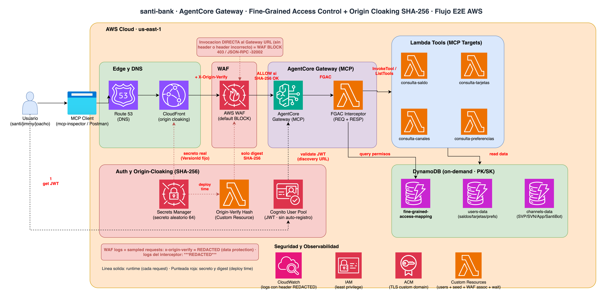

> 🔐 El detalle del origin cloaking con SHA-256 (cómo llega el digest al WAF en deploy time, cómo se valida cada request y cómo se rota) está en su propio diagrama: [`assets/santi-bank-origin-verify-sha256.png`](./assets/santi-bank-origin-verify-sha256.png). Ver [sección 7.3](#73--origin-cloaking-el-gateway-solo-acepta-tráfico-de-cloudfront-waf--secrets-manager).

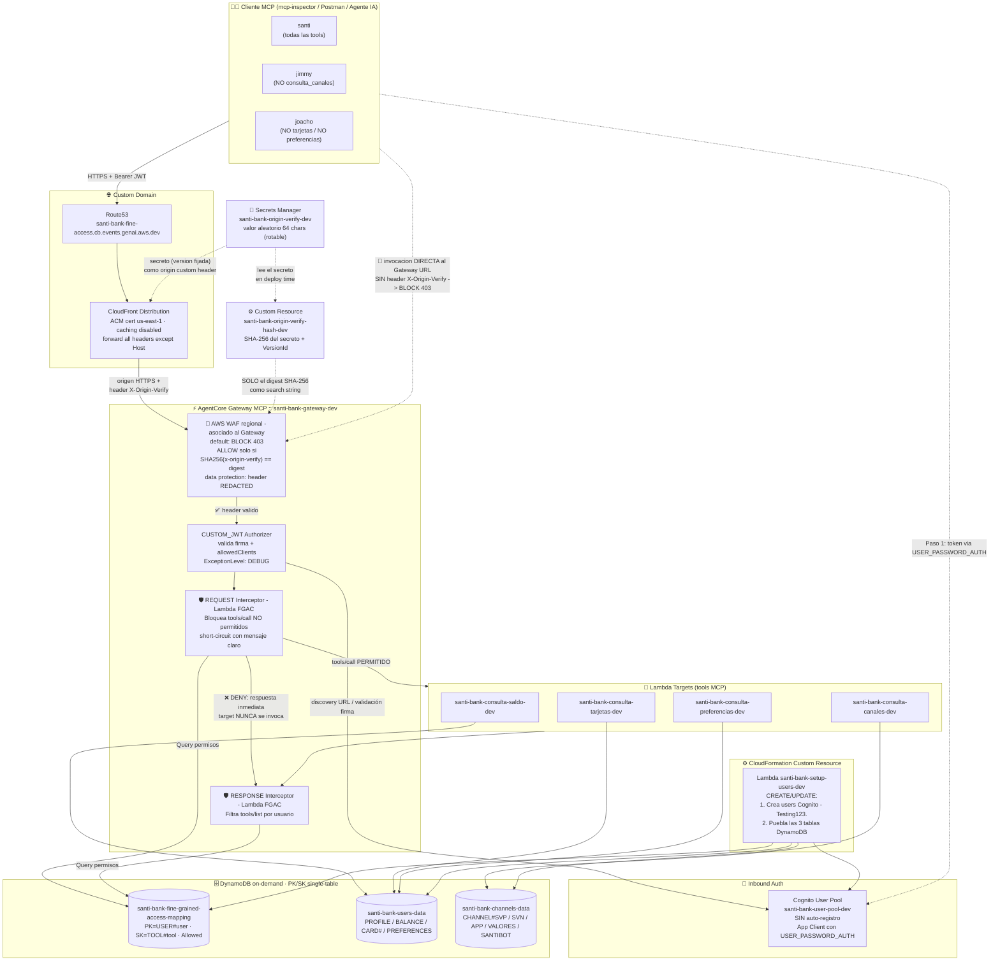

---

## 3. Flujos detallados (Mermaid)

### 3.1 Flujo de autenticación (obtener el JWT)

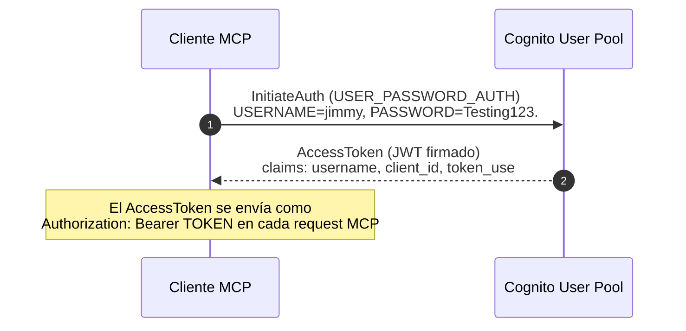

### 3.2 Flujo `tools/list` — filtrado por RESPONSE Interceptor (Hipótesis 1A)

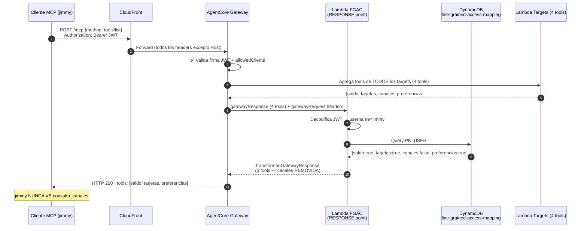

### 3.3 Flujo `tools/call` PERMITIDO — REQUEST Interceptor deja pasar

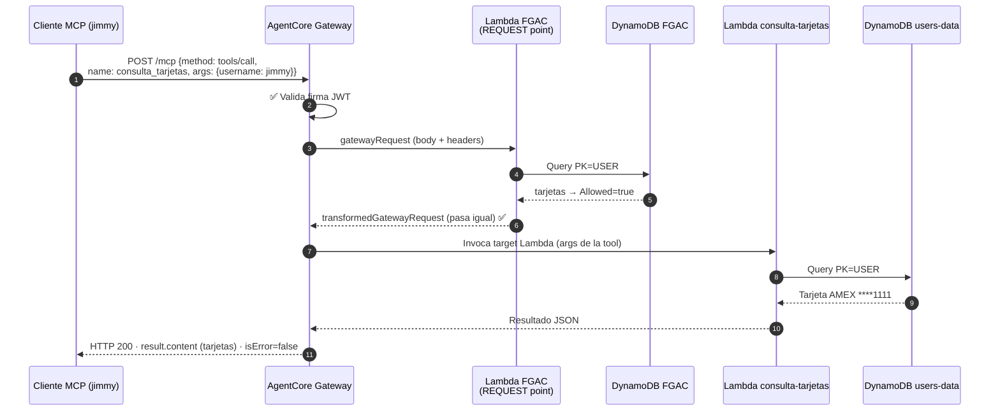

### 3.4 Flujo `tools/call` DENEGADO — short-circuit ⭐ (Hipótesis 1B: "la ves pero NO la ejecutas")

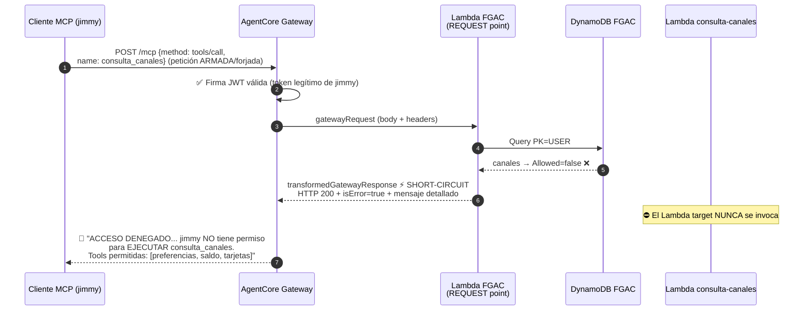

### 3.5 Flujo de errores de autenticación (Hipótesis 2)

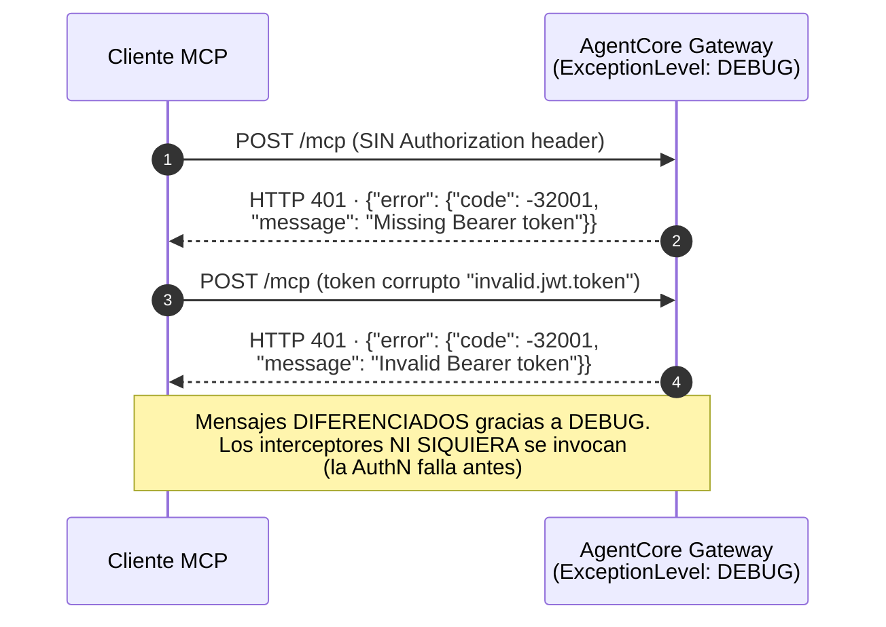

---

## 4. Componentes desplegados

| Componente | Nombre del recurso | Propósito |
|---|---|---|
| AgentCore Gateway | `santi-bank-gateway-dev` | Endpoint MCP con Inbound Auth JWT + interceptores |
| Custom Domain | `santi-bank-fine-access.cb.events.genai.aws.dev` | DNS amigable → CloudFront → Gateway |
| CloudFront | `d4te0tuscgxgn.cloudfront.net` | TLS con cert propio, forward de headers |
| Cognito User Pool | `santi-bank-user-pool-dev` | Identidad (SIN auto-registro) |
| Cognito App Client | `santi-bank-mcp-client-dev` | USER_PASSWORD_AUTH, sin secret |
| Lambda Interceptor | `santi-bank-fgac-interceptor-dev` | FGAC en REQUEST + RESPONSE |
| Lambda Tool 1 | `santi-bank-consulta-saldo-dev` | Saldo de un usuario (users-data) |
| Lambda Tool 2 | `santi-bank-consulta-tarjetas-dev` | Tarjetas crédito/débito (users-data) |
| Lambda Tool 3 | `santi-bank-consulta-canales-dev` | Estado de TODOS los canales (channels-data, scan) |
| Lambda Tool 4 | `santi-bank-consulta-preferencias-dev` | Preferencias app (users-data) |
| Lambda Setup | `santi-bank-setup-users-dev` | Custom Resource: users + seed data |
| Lambda WAF Assoc | `santi-bank-waf-association-dev` | Custom Resource: asocia el WebACL al Gateway (con reintentos + auto-refresh del gateway) |
| DynamoDB 1 | `santi-bank-fine-grained-access-mapping` | Matriz de permisos (FGAC) |
| DynamoDB 2 | `santi-bank-users-data` | Datos bancarios de usuarios |
| DynamoDB 3 | `santi-bank-channels-data` | Estado de canales |
| Lambda Origin-Verify Hash | `santi-bank-origin-verify-hash-dev` | Custom Resources: (1) lee el secreto en deploy time y entrega SOLO su SHA-256 (actual + anterior) y el VersionId, rota el secreto si cambia `origin_verify_rotation_id`; (2) espera la propagación del WAF antes de que CloudFront cambie el header |
| WAF WebACL (regional) | `santi-bank-gateway-waf-dev` | Origin cloaking: asociado DIRECTAMENTE al Gateway, regla `SHA256(header) == digest` + data protection del header |
| Secrets Manager | `santi-bank-origin-verify-dev` | Secreto compartido CloudFront ↔ WAF: aleatorio de 64 caracteres generado por CloudFormation (el WAF solo ve su hash) |
| CloudWatch Logs (WAF) | `aws-waf-logs-santi-bank-gateway-dev` | Logging de requests permitidos/bloqueados por WAF |

### Matriz de permisos (seed inicial)

| Usuario | consulta_saldo | consulta_tarjetas | consulta_canales | consulta_preferencias | Tools visibles |
|---|:---:|:---:|:---:|:---:|:---:|
| `santi` | ✅ | ✅ | ✅ | ✅ | **4** |
| `jimmy` | ✅ | ✅ | ❌ | ✅ | **3** |
| `joacho` | ✅ | ❌ | ✅ | ❌ | **2** |

> 🔥 **Permisos DINÁMICOS**: cambia el atributo `Allowed` (true/false) en DynamoDB y el cambio aplica **inmediatamente** (listado + ejecución), **sin redeploy**.

---

## 5. Modelo de datos DynamoDB

Las 3 tablas usan **single-table design** con `PK`/`SK` (billing **on-demand / PAY_PER_REQUEST**).

### 5.1 `santi-bank-fine-grained-access-mapping` (la tabla FGAC ⭐)

| PK | SK | Allowed | GrantedBy |
|---|---|:---:|---|
| `USER#santi` | `TOOL#consulta_saldo` | `true` | santi-bank-custom-resource |
| `USER#jimmy` | `TOOL#consulta_canales` | `false` | santi-bank-custom-resource |
| `USER#joacho` | `TOOL#consulta_tarjetas` | `false` | santi-bank-custom-resource |

- El interceptor hace `Query PK=USER#<username>` (1 sola lectura por request).
- **Ausencia del item** o `Allowed=false` ⇒ **DENY (fail-closed)**.
- Items explícitos con `false` facilitan la lectura de la matriz y el flip dinámico.

### 5.2 `santi-bank-users-data`

| PK | SK | Ejemplo de atributos |
|---|---|---|
| `USER#santi` | `PROFILE` | full_name, document, segment, email |
| `USER#santi` | `BALANCE` | available_balance: 15750000.50, currency: COP, account_type |
| `USER#santi` | `CARD#CREDIT-VISA-4321` | brand, masked_number, status, credit_limit |
| `USER#santi` | `PREFERENCES` | nickname, color_app (Blanco/Negro), tope_cajero, tope_transaccion, contacto_emergencia |

### 5.3 `santi-bank-channels-data`

| PK | SK | channel_name | status |
|---|---|---|---|
| `CHANNEL#SVP` | `STATUS` | Sucursal Virtual Personas (SVP) | OPERATIVO |
| `CHANNEL#SVN` | `STATUS` | Sucursal Virtual Negocios (SVN) | OPERATIVO |
| `CHANNEL#APP-MIBANCOAPP` | `STATUS` | MiBancoApp (App) | DEGRADADO |
| `CHANNEL#VALORES` | `STATUS` | Valores santi-bank | OPERATIVO |
| `CHANNEL#SANTIBOT` | `STATUS` | SantiBot (WhatsApp) | MANTENIMIENTO |

---

## 6. Interceptores: REQUEST vs RESPONSE

Un Gateway soporta **máximo 1 interceptor REQUEST y 1 RESPONSE**. Este repo usa **UN solo Lambda** (`santi-bank-fgac-interceptor-dev`) conectado a ambos puntos (detecta el punto por la presencia de `gatewayResponse` en el evento).

### 6.1 Comparativa de los dos puntos de intercepción

| Aspecto | REQUEST Interceptor | RESPONSE Interceptor |
|---|---|---|
| **Cuándo se ejecuta** | ANTES de invocar el target | DESPUÉS del target, antes de responder al cliente |
| **Caso de uso aquí** | Bloquear `tools/call` no autorizado (**InvokeTool**) | Filtrar `tools/list` (**ListTools**) |
| **Input clave** | `mcp.gatewayRequest` (body + headers) | `mcp.gatewayResponse` + `mcp.gatewayRequest` |
| **Output para dejar pasar** | `transformedGatewayRequest` | `transformedGatewayResponse` (igual) |
| **Output para BLOQUEAR** | `transformedGatewayResponse` ⚡ (**short-circuit**: el Gateway responde YA y el target NUNCA se invoca) | `transformedGatewayResponse` (modificada) |
| **¿Puede leer el JWT?** | Sí, con `passRequestHeaders: true` | Sí, con `passRequestHeaders: true` |

> ⚠️ **Detalle importante de la documentación**: si el REQUEST interceptor retorna `transformedGatewayResponse` (short-circuit), el RESPONSE interceptor **IGUAL se invoca** después. Por eso el handler RESPONSE hace *pass-through* de todo lo que no sea un `tools/list` (incluidos los DENY del REQUEST).

### 6.2 Comparativa: setup original del equipo vs setup recomendado (este repo)

| Aspecto | ❌ Solo RESPONSE (setup original) | ✅ REQUEST + RESPONSE (este repo) |
|---|---|---|
| Usuario ve solo sus tools | ✅ | ✅ |
| Petición ARMADA (`tools/call` forjado) | ⚠️ La tool YA se ejecutó cuando validas | 🛡️ Bloqueada ANTES de ejecutar (short-circuit) |
| Permiso revocado en caliente | ⚠️ Ejecuta hasta el próximo re-listado | 🛡️ Bloqueo inmediato en la siguiente invocación |
| "La ves pero NO la ejecutas" | ❌ Imposible | ✅ Nativo |
| Costo | 1 invocación Lambda por request | 2 invocaciones Lambda por request (REQUEST + RESPONSE) |

### 6.3 Contrato del interceptor (payloads)

**Input (REQUEST point):**

```json
{
  "interceptorInputVersion": "1.0",
  "mcp": {
    "gatewayRequest": {
      "path": "/mcp",
      "httpMethod": "POST",
      "headers": { "Authorization": "Bearer <JWT>" },
      "body": { "jsonrpc": "2.0", "id": 2, "method": "tools/call",
                "params": { "name": "consulta-canales___consulta_canales", "arguments": {} } }
    }
  }
}
```

**Output DENY (short-circuit):**

```json
{
  "interceptorOutputVersion": "1.0",
  "mcp": {
    "transformedGatewayResponse": {
      "statusCode": 200,
      "body": {
        "jsonrpc": "2.0", "id": 2,
        "result": {
          "content": [{ "type": "text", "text": "🚫 ACCESO DENEGADO por santi-bank FGAC: ..." }],
          "isError": true
        }
      }
    }
  }
}
```

---

## 7. Manejo de errores (Hipótesis 2)

### 7.1 Comparativa de estrategias de DENY

| Estrategia | Qué ve el cliente MCP | Ventaja | Desventaja |
|---|---|---|---|
| HTTP 403/500 (status ≠ 200) | ⚠️ Error de transporte **GENÉRICO** — el mensaje rico se pierde en la mayoría de clientes MCP | Semántica HTTP "correcta" | **Este era el dolor del equipo**: "StatusCode ≠ 200 da SIEMPRE el mismo mensaje" |
| ✅ **HTTP 200 + `result.isError: true`** (modo `mcp_error`, default) | Mensaje completo: usuario, tool bloqueada, tools permitidas | El **agente LLM puede LEER el motivo y reaccionar** (p.ej. usar otra tool) | Requiere que el cliente respete `isError` |
| HTTP 200 + JSON-RPC `error` (modo `jsonrpc_error`) | Error de protocolo con `code: -32003` + `data` estructurada | Estándar JSON-RPC, data parseable | Algunos clientes lo muestran como fallo de protocolo |

> El modo se cambia con la variable de entorno `DENY_MODE` del Lambda interceptor (configurable en `cdk.json` → `interceptor_deny_mode`).

### 7.2 Comparativa `ExceptionLevel` del Gateway

| Escenario | Sin `ExceptionLevel` (default) | Con `ExceptionLevel: DEBUG` (este repo) |
|---|---|---|
| Token vacío | Mensaje genérico | `HTTP 401 · "Missing Bearer token"` |
| Token inválido/corrupto | Mensaje genérico (igual al anterior) | `HTTP 401 · "Invalid Bearer token"` (¡DIFERENTE!) |
| Error interno de un target Lambda | Mensaje genérico | Detalle del error de invocación |

En CDK (1 línea):

```python
exception_level=agentcore.GatewayExceptionLevel.DEBUG,
```

### 7.3 🎯 Origin Cloaking: el Gateway SOLO acepta tráfico de CloudFront (WAF + Secrets Manager)

El endpoint del Gateway (`*.gateway.bedrock-agentcore.*.amazonaws.com`) es público por naturaleza. Para que **solo CloudFront pueda llegarle**, el stack implementa *origin cloaking* con [WAF asociado directamente al AgentCore Gateway](https://docs.aws.amazon.com/bedrock-agentcore/latest/devguide/gateway-waf.html). Desde 2026-11-19 la regla compara un **hash SHA-256**, así que el secreto ya no queda guardado en el WAF.

> 📐 Diagrama dedicado del flujo SHA-256 (deploy time, runtime, qué ve cada quién y rotación): [`assets/santi-bank-origin-verify-sha256.drawio`](./assets/santi-bank-origin-verify-sha256.drawio) · PNG DPI-400: [`assets/santi-bank-origin-verify-sha256.png`](./assets/santi-bank-origin-verify-sha256.png)

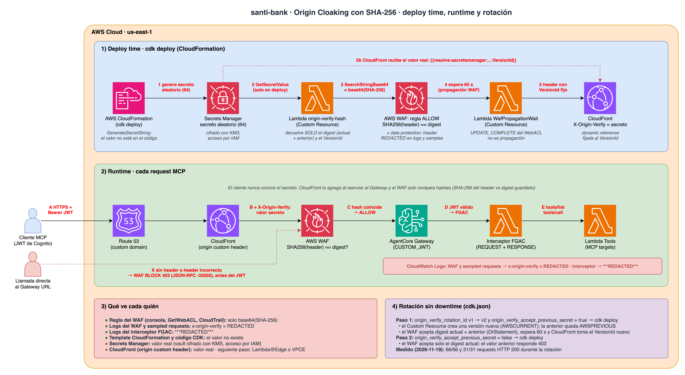

**La idea en una frase:** CloudFront conoce el secreto y lo envía en cada request; el WAF solo conoce su huella (SHA-256), calcula el SHA-256 del header que recibe y compara huellas. Quien lea la configuración del WAF solo ve un hash irreversible.

**Fase 1: deploy time (en cada `cdk deploy` que cambie el secreto o la regla)**

| # | Quién | Qué hace |
|---|---|---|
| 1 | CloudFormation | Genera el secreto aleatorio de 64 caracteres en Secrets Manager (`GenerateSecretString`). El valor nunca pasa por el código ni por el template |
| 2 | Lambda `santi-bank-origin-verify-hash-dev` (Custom Resource) | Lee el secreto (`GetSecretValue` de `AWSCURRENT` y `AWSPREVIOUS`) y calcula `base64(SHA-256)`. Devuelve a CloudFormation **solo** los digests y el `VersionId` actual |
| 3 | CloudFormation → WAF | Escribe el digest en la regla: `SearchStringBase64` + `TextTransformation: SHA256` + `EXACTLY`, y activa la data protection del header |
| 4 | Lambda `WafPropagationWait` (Custom Resource) | Espera 60 s para que todos los hosts del WAF tengan la regla nueva antes de tocar CloudFront |
| 5 | CloudFormation → CloudFront | Resuelve `{{resolve:secretsmanager:<arn>:SecretString:::<VersionId>}}` y pone el valor real en el origin header `X-Origin-Verify` |

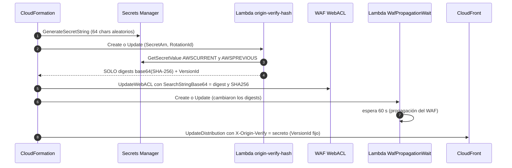

**Fase 2: runtime (cada request MCP)**

| # | Paso | Detalle |
|---|---|---|
| A | Cliente → Route 53 → CloudFront | HTTPS + `Authorization: Bearer <JWT de Cognito>`. El cliente **no conoce** el secreto |
| B | CloudFront → Gateway | Agrega `X-Origin-Verify: <secreto>` (si el cliente manda un header con ese nombre, CloudFront lo reemplaza) |
| C | WAF del Gateway | Calcula `SHA256(header)` y lo compara con el digest guardado. Coincide → ALLOW. No coincide o no viene → `403` con JSON-RPC `-32002`, **antes** del JWT |
| D | AgentCore Gateway | Valida el JWT (`CUSTOM_JWT`) y llama al interceptor FGAC |
| E | Interceptor FGAC | Filtra `tools/list` y bloquea los `tools/call` no permitidos. Loguea el evento con `x-origin-verify` = `***REDACTED***` |

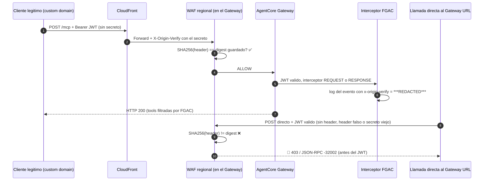

| Componente | Configuración |
|---|---|
| **Secreto compartido** | Secrets Manager `santi-bank-origin-verify-dev`: valor **aleatorio de 64 caracteres** generado por CloudFormation (`GenerateSecretString`). No existe en el código ni en el template |
| **Digest (Custom Resource)** | Lambda `santi-bank-origin-verify-hash-dev`: en deploy time lee el secreto y devuelve SOLO `base64(SHA-256)` del valor actual y del anterior + el `VersionId` actual. Nunca loguea ni devuelve el secreto |
| **CloudFront** | Origin custom header `X-Origin-Verify: <secreto>` vía *dynamic reference* **fijada al `VersionId`** del digest: si el secreto rota, CloudFront se actualiza en el mismo deploy |
| **WAF WebACL regional** | Default action **BLOCK (403)**. Única regla ALLOW: `single_header x-origin-verify`, text transformation **`SHA256`**, `EXACTLY == digest` (`SearchStringBase64`). Asociado al Gateway con `wafv2 associate-web-acl` (custom resource) |
| **Data protection** | `DataProtectionConfig` del WebACL: `SINGLE_HEADER x-origin-verify` con acción `SUBSTITUTION` (sale `REDACTED` en logs Y sampled requests; el `RedactedFields` del logging no cubre sampled requests) |
| **Failure mode** | `FAIL_CLOSE` (default del Gateway: si WAF no responde, se bloquea) |
| **Logging** | Log group `aws-waf-logs-santi-bank-gateway-dev` + métricas `WafBlocks` en `AWS/Bedrock-AgentCore` y métricas del WebACL. El interceptor FGAC también redacta `x-origin-verify` antes de loguear el evento |

**Resultado validado:**

| Invocación (siempre con JWT válido) | Header `X-Origin-Verify` | Resultado |
|---|---|---|
| Vía `santi-bank-fine-access.cb.events.genai.aws.dev` | ✅ CloudFront inyecta el secreto | ✅ `200`, flujo completo (JWT → interceptores → tools) |
| Directa al Gateway URL | ❌ no viene | 🚫 **`403` / `-32002`** |
| Directa, header aleatorio | ❌ el hash no coincide | 🚫 **`403`** |
| Directa, `santi-aws` (valor demo viejo) | ❌ el hash no coincide | 🚫 **`403`** |
| Directa, secreto rotado (`AWSPREVIOUS`) | ❌ ya no está en la regla | 🚫 **`403`** |
| Directa con el secreto correcto (prueba de laboratorio de `validate_fgac.py`) | ✅ el hash coincide | ✅ `200`: prueba que el WAF calcula el SHA-256 del header |

> ⚠️ Nota de seguridad: la allowlist de IPs de CloudFront NO basta por sí sola (esas IPs son compartidas por todas las distribuciones del mundo), por eso el header secreto es el control determinante. Compleméntalo con WAF managed rules + rate limiting en el CloudFront. El control fuerte de identidad sigue siendo el JWT (Inbound Auth) + los interceptores.

#### 7.3.1 🔐 SHA-256: el WAF ya no guarda el secreto en claro

**Hallazgo de Ciber (2026-11-19):** con la regla original (`ByteMatch` + `NONE`), el valor exacto del header quedaba visible en la configuración del WAF (`GetWebACL`, consola, CloudTrail de `UpdateWebACL`) aunque el secreto viviera en Secrets Manager y se rotara. AWS WAF no se integra con Secrets Manager, así que la solución es **no guardar el secreto en el WAF**:

1. AWS WAF soporta la [text transformation `SHA256`](https://docs.aws.amazon.com/waf/latest/developerguide/waf-rule-statement-transformation.html): calcula el SHA-256 del header recibido (salida binaria cruda) **antes** de comparar.
2. La regla guarda solo `base64(SHA-256(secreto))` en `SearchStringBase64`, con `PositionalConstraint: EXACTLY`.
3. Un hash SHA-256 no se puede revertir **si el secreto es aleatorio y largo**: por eso el valor demo `santi-aws` se reemplazó por 64 caracteres aleatorios (con un valor adivinable, el hash se rompe por diccionario offline). El custom resource falla el deploy si el secreto tiene menos de 32 caracteres.
4. CloudFormation no puede calcular un SHA-256 de un *dynamic reference*: por eso existe el custom resource, que lee el secreto en deploy time y entrega solo el hash (nunca loguea ni devuelve el valor).

Así queda el valor en cada lugar:

| Dónde | Antes (`NONE`) | Ahora (`SHA256`) |
|---|---|---|
| Regla del WAF (consola, `GetWebACL`, CloudTrail `UpdateWebACL`) | 🔴 valor en claro | 🟢 solo el digest SHA-256 |
| Template de CloudFormation / código CDK | 🔴 `santi-aws` en `SecretString` | 🟢 no existe (`GenerateSecretString`) |
| Logs del WAF y sampled requests | 🔴 header en claro | 🟢 `REDACTED` (data protection) |
| Logs del interceptor FGAC (`passRequestHeaders: true`) | 🔴 header en claro | 🟢 `***REDACTED***` |
| Secrets Manager | 🟡 valor (cifrado con KMS, acceso por IAM) | 🟡 igual: es el vault |
| CloudFront (origin custom header) | 🔴 valor en claro | 🔴 sigue en claro (ver 7.3.3) |

Validarlo uno mismo (el digest es público por diseño, el secreto nunca se imprime):

```bash
# Lo que ve cualquiera con wafv2:GetWebACL: solo base64(SHA-256) + transformation SHA256
aws wafv2 get-web-acl --scope REGIONAL --name santi-bank-gateway-waf-dev --id <id> \
  --query "WebACL.Rules[0].Statement" --region us-east-1
```

#### 7.3.2 🔄 Rotación del secreto sin downtime

Rotar = crear un nuevo valor en Secrets Manager, aceptar **ambos** digests en el WAF mientras CloudFront propaga y luego retirar el anterior:

| Paso | `cdk.json` (`app_config.dev`) | Qué pasa |
|---|---|---|
| 1 | Subir `origin_verify_rotation_id` (ej. `v1` → `v2`) + `origin_verify_accept_previous_secret: true` → `cdk deploy` | El custom resource crea una versión nueva aleatoria (idempotente) → el WAF acepta digest nuevo **y** anterior (`OrStatement`) → espera de propagación del WAF (`origin_verify_waf_propagation_seconds`, 60 s) → CloudFront toma el nuevo `VersionId` |
| 2 | `origin_verify_accept_previous_secret: false` → `cdk deploy` | El WAF acepta solo el digest actual: el valor anterior queda inválido |

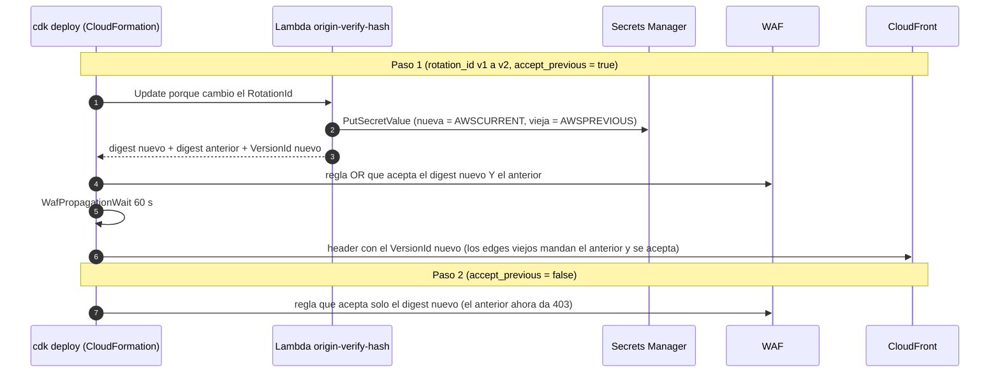

> 🧪 **Aprendizaje real (2026-11-19):** en la primera migración, sin la espera, CloudFormation marcó el WebACL `UPDATE_COMPLETE` y 9 s después un edge de CloudFront ya enviaba el valor nuevo a un host del WAF que todavía tenía la regla vieja: **1 request con 403** de ~60 (medido con un monitor cada 3 s). Por eso existe `CustomResource-WafPropagationWait`: CloudFront depende de esa espera, no solo del WebACL.

> 💡 Para el banco: si la rotación la hace una Lambda propia (Secrets Manager rotation), la lógica es la misma: escribir en el WAF `base64(SHA-256)` de `AWSCURRENT` y `AWSPENDING` durante la ventana, actualizar CloudFront y luego dejar solo el digest actual.

#### 7.3.3 ⚠️ Límites conocidos y siguiente paso

- **CloudFront sigue guardando el valor en claro** en el origin custom header (consola y `GetDistributionConfig`), igual que cualquier esquema de secreto compartido. Opciones para cerrarlo: inyectar el header con **Lambda@Edge (origin request)** leyendo Secrets Manager en runtime (el valor solo vive en el vault) o con CloudFront Functions + KeyValueStore (sale de la config de la distribución, con IAM propio).
- **Arquitectura sin secreto**: VPC endpoint `com.amazonaws.<region>.bedrock-agentcore.gateway` + *resource-based policy* del Gateway que solo permite `bedrock-agentcore:InvokeGateway` con `aws:SourceVpce`, con CloudFront VPC origins al frente. Ahí no hay secreto que esconder ni rotar (pendiente POC del enrutamiento por hostname del Gateway).

---

## 8. Despliegue paso a paso

### 8.1 Prerrequisitos

| Herramienta | Versión probada | Verificar con |
|---|---|---|
| AWS CLI v2 (credenciales activas) | 2.x | `aws sts get-caller-identity` |
| AWS CDK CLI | 2.1130.0 | `cdk --version` |
| Python | 3.12 / 3.13 | `python3 --version` |
| Poetry | 2.1.3 | `poetry --version` |
| Node.js (para CDK y mcp-inspector) | 22/24 | `node --version` |
| Cuenta bootstrapeada con CDK | - | `aws cloudformation describe-stacks --stack-name CDKToolkit` |
| Hosted Zone en Route53 | `cb.events.genai.aws.dev` | ya existente (config en `cdk.json`) |

### 8.2 Pasos

```bash
# 1. Clonar / entrar al repo
cd aws-agentcore-fine-grained-access-bank-demo/infrastructure

# 2. Instalar dependencias (Poetry con .venv en el root del proyecto CDK)
poetry config virtualenvs.in-project true
poetry install

# 3. (Opcional) Revisar la configuración por ambiente
cat cdk.json   # app_config.dev: nombres de tablas, dominio, deny mode, etc.

# 4. Sintetizar (valida el template de CloudFormation)
poetry run cdk synth

# 5. Ver el diff contra lo desplegado (si aplica)
poetry run cdk diff

# 6. Desplegar TODO (~8-12 min por ACM + CloudFront)
poetry run cdk deploy --all --require-approval never

# 7. Ver outputs del stack
aws cloudformation describe-stacks --stack-name santi-bank-fine-access-dev \
  --query "Stacks[0].Outputs" --output table
```

> También hay `Makefile`: `make install`, `make synth`, `make diff`, `make deploy`, `make destroy`.

### 8.3 ¿Qué hace el despliegue automáticamente? (Custom Resource)

El Custom Resource (`santi-bank-setup-users-dev`) corre en **CREATE y UPDATE** del stack (idempotente) y deja todo listo:

| Paso | Acción |
|---|---|
| 1 | Crea usuarios Cognito `santi`, `jimmy`, `joacho` con password **permanente** `Testing123.` (sin flujo de verificación) |
| 2 | Puebla `santi-bank-users-data` (perfiles, saldos, tarjetas, preferencias) |
| 3 | Puebla `santi-bank-channels-data` (SVP, SVN, App, Valores, SantiBot) |
| 4 | Puebla `santi-bank-fine-grained-access-mapping` (matriz de permisos) |

Adicionalmente, el stack tiene otros Custom Resources para el origin cloaking:

| Custom Resource | Lambda | Qué hace |
|---|---|---|
| `WAF-GatewayAssociation` | `santi-bank-waf-association-dev` | Asocia el WebACL **directamente al AgentCore Gateway** (`wafv2 associate-web-acl`), con lógica de resiliencia (ver 8.5) |
| `CustomResource-OriginVerifyHash` | `santi-bank-origin-verify-hash-dev` | Lee el secreto y entrega SOLO su SHA-256 (actual + anterior) y el `VersionId`. Si cambia `origin_verify_rotation_id`, crea una versión nueva del secreto (ver 7.3.2) |
| `CustomResource-WafPropagationWait` | `santi-bank-origin-verify-hash-dev` (modo espera) | Espera `origin_verify_waf_propagation_seconds` (60 s) entre el WebACL y CloudFront cuando cambian los digests |

### 8.4 Outputs del stack (valores reales del despliegue)

| Output | Valor |
|---|---|
| `CustomDomainMcpUrl` | `https://santi-bank-fine-access.cb.events.genai.aws.dev/mcp` |
| `GatewayUrl` | `https://santi-bank-gateway-dev-kiogzebcfh.gateway.bedrock-agentcore.us-east-1.amazonaws.com/mcp` |
| `CognitoUserPoolId` | `us-east-1_Z0amGv9rk` |
| `CognitoAppClientId` | `4ilvj9e26ovcv37g152tranglc` |
| `CloudFrontDomain` | `d4te0tuscgxgn.cloudfront.net` |
| `WafWebAclArn` | ARN del WebACL `santi-bank-gateway-waf-dev` (asociado al Gateway) |
| `OriginVerifySecretName` | `santi-bank-origin-verify-dev` (Secrets Manager) |
| `OriginVerifySecretVersionId` | `VersionId` del secreto que usan CloudFront y el digest del WAF (cambia al rotar) |
| `WafLogGroupName` | `aws-waf-logs-santi-bank-gateway-dev` |

### 8.5 🔧 Troubleshooting: asociación WAF ↔ AgentCore Gateway (aprendizajes reales)

Hallazgos empíricos de este despliegue (automatizados en `backend/lambdas/waf_association/handler.py`):

| # | Síntoma | Causa raíz | Solución |
|---|---|---|---|
| 1 | `WAFUnavailableEntityException: AWS WAF couldn't retrieve the resource... Retry your request` **persistente** (no transitorio) al asociar | La infraestructura del Gateway existente no estaba aprovisionada para WAF | Ejecutar un **`UpdateGateway` NO-OP** (misma config) → re-aprovisiona el data plane → esperar `READY` → reintentar la asociación (funciona al primer intento) |
| 2 | `ValidationException: wafConfiguration can only be set when a WebACL is associated with the gateway` | El `wafConfiguration` (FAIL_CLOSE/FAIL_OPEN) **NO** puede setearse antes de asociar | Asociar primero; el failure mode default ya es `FAIL_CLOSE` |
| 3 | `AccessDeniedException ... wafv2:GetWebACL` al verificar con `get-web-acl-for-resource` | Esa API requiere **`wafv2:GetWebACL`** además de `GetWebACLForResource` | Incluir ambos permisos en el rol del custom resource |
| 4 | `AlreadyExists / duplicate` del WebACL en re-despliegues tras un rollback | Un WebACL **asociado** no puede borrarse en rollback → queda huérfano | Disociar (`disassociate-web-acl`) + borrar (`delete-web-acl` con lock token) antes de re-desplegar |
| 5 | `AWS::WAFv2::WebACLAssociation` (CloudFormation) | No documenta soporte para ARNs `bedrock-agentcore` | Custom resource Lambda llamando `wafv2:AssociateWebACL` directamente |
| 6 | `Value '...(SHA-256 match)' at 'description' failed to satisfy constraint: Member must satisfy regular expression pattern` | La `Description` del WebACL solo acepta `[\w+=:#@/\-,\.]` y espacios: **sin paréntesis** | Descripción sin paréntesis (el deploy hace rollback completo, sin impacto en el tráfico) |
| 7 | 1 request con 403 justo al cambiar el header en CloudFront | `UPDATE_COMPLETE` del WebACL no significa que todos los hosts del WAF tengan la regla nueva | `Custom::WafPropagationWait` (60 s) entre el WebACL y CloudFront |
| 8 | `WARNING ... 'SHA256' is not one of [...] (CloudFormation Validate)` en `cdk synth` | El schema de CloudFormation que trae esta versión de CDK es anterior a la transformation `SHA256` (la referencia oficial ya la lista) | Warning reconocido en el código (`CloudFormation-Validate::W3030`); el deploy funciona |

---

## 9. Cómo probarlo con MCP-Inspector

> 🧱 **Importante (origin cloaking activo)**: usa SIEMPRE el **custom domain** — la invocación directa al Gateway URL retorna `403 Forbidden - Request blocked by AWS WAF`, incluso con JWT válido (¡ese es el feature!).

### 9.1 Obtener un token JWT (por usuario)

```bash
CLIENT_ID="<CognitoAppClientId del output>"

aws cognito-idp initiate-auth --region us-east-1 \
  --auth-flow USER_PASSWORD_AUTH \
  --client-id $CLIENT_ID \
  --auth-parameters USERNAME=jimmy,PASSWORD=Testing123. \
  --query "AuthenticationResult.AccessToken" --output text
```

### 9.2 Modo UI (interfaz web)

```bash
npx @modelcontextprotocol/inspector
```

| Campo | Valor |
|---|---|
| **Transport Type** | `Streamable HTTP` |
| **URL** | `https://santi-bank-fine-access.cb.events.genai.aws.dev/mcp` |
| **Authentication → Bearer Token** | El AccessToken del usuario (santi/jimmy/joacho) |

Luego: **Connect** → **List Tools** → invoca tools con `Run Tool`.

### 9.3 Modo CLI (headless, ideal para demos rápidas)

```bash
DOMAIN="https://santi-bank-fine-access.cb.events.genai.aws.dev/mcp"
TOKEN="<AccessToken>"

# Listar tools (verás el filtrado FGAC por usuario)
npx @modelcontextprotocol/inspector --cli $DOMAIN --transport http \
  --header "Authorization: Bearer $TOKEN" --method tools/list

# Invocar una tool PERMITIDA
npx @modelcontextprotocol/inspector --cli $DOMAIN --transport http \
  --header "Authorization: Bearer $TOKEN" --method tools/call \
  --tool-name "consulta-tarjetas___consulta_tarjetas" --tool-arg username=jimmy

# Invocar una tool DENEGADA (petición "armada": jimmy NO tiene canales)
npx @modelcontextprotocol/inspector --cli $DOMAIN --transport http \
  --header "Authorization: Bearer $TOKEN" --method tools/call \
  --tool-name "consulta-canales___consulta_canales"
```

> 📛 **Naming de tools**: el Gateway expone cada tool como `<target-name>___<tool_name>` (triple underscore). Ejemplo: `consulta-saldo___consulta_saldo`.

### 9.4 Resultados esperados por usuario

| Usuario | tools/list muestra | Tool bloqueada al invocar |
|---|---|---|
| `santi` | las 4 tools | ninguna |
| `jimmy` | saldo, tarjetas, preferencias (3) | `consulta_canales` 🚫 |
| `joacho` | saldo, canales (2) | `consulta_tarjetas` y `consulta_preferencias` 🚫 |

---

## 10. Cómo probarlo con Postman

### 10.0 ⭐ Colección lista para importar (recomendado)

Importa [`postman/santi-bank-fgac.postman_collection.json`](./postman/santi-bank-fgac.postman_collection.json) (Postman → **Import** → arrastra el archivo). Incluye:

| Feature | Detalle |
|---|---|
| **Variables pre-configuradas** | `mcp_url`, `gateway_url_direct`, `client_id`, `password` — cero setup |
| **Auto-autenticación por usuario** 🔑 | Cada folder (santi/jimmy/joacho) tiene un pre-request script que hace login en Cognito automáticamente y cachea el token 6h. Solo abre el folder y dale **Send** |
| **47 tests automáticos** | Filtrado de `tools/list`, DENY con `isError:true` + mensaje, errores 401 diferenciados, origin cloaking |
| **Folder 0 (opcional)** | Logins explícitos para VER el flujo Cognito en una demo |
| **Folder 5 (opcional)** | Grant/revoke dinámico vía DynamoDB con SigV4 (requiere setear credenciales AWS en las variables) |
| **Folder 6 (WAF)** 🧱 | Origin cloaking: invocación DIRECTA al Gateway URL → bloqueada (403/-32002) vs vía CloudFront → 200 OK |

**Collection Runner**: corre los folders 0–4 completos → todos los tests en verde. También headless:

```bash
npx newman run postman/santi-bank-fgac.postman_collection.json \
  --folder "1. santi (acceso TOTAL - 4 tools)" \
  --folder "2. jimmy (SIN consulta_canales - 3 tools)" \
  --folder "3. joacho (solo saldo + canales - 2 tools)" \
  --folder "4. Errores de Auth (Hipotesis 2)"
# Resultado validado: 43/43 assertions ✅
```

Las siguientes subsecciones explican los requests **manualmente** (por si quieres armarlos desde cero):

### 10.1 Request 1 — Obtener el token (Cognito)

| Campo | Valor |
|---|---|
| Método | `POST` |
| URL | `https://cognito-idp.us-east-1.amazonaws.com/` |
| Header | `Content-Type: application/x-amz-json-1.1` |
| Header | `X-Amz-Target: AWSCognitoIdentityProviderService.InitiateAuth` |

**Body (raw / JSON):**

```json
{
  "AuthFlow": "USER_PASSWORD_AUTH",
  "ClientId": "4ilvj9e26ovcv37g152tranglc",
  "AuthParameters": {
    "USERNAME": "jimmy",
    "PASSWORD": "Testing123."
  }
}
```

➡️ Copia `AuthenticationResult.AccessToken` de la respuesta (guárdalo en una variable de Postman, p.ej. `{{access_token}}`).

### 10.2 Request 2 — `tools/list` (MCP)

| Campo | Valor |
|---|---|
| Método | `POST` |
| URL | `https://santi-bank-fine-access.cb.events.genai.aws.dev/mcp` |
| Header | `Content-Type: application/json` |
| Header | `Accept: application/json, text/event-stream` |
| Header | `Authorization: Bearer {{access_token}}` |

**Body (raw / JSON):**

```json
{ "jsonrpc": "2.0", "id": 1, "method": "tools/list", "params": {} }
```

✅ **Esperado (jimmy)**: HTTP 200 con SOLO 3 tools (sin `consulta_canales`).

### 10.3 Request 3 — `tools/call` permitido

Misma URL/headers. **Body:**

```json
{
  "jsonrpc": "2.0", "id": 2, "method": "tools/call",
  "params": {
    "name": "consulta-saldo___consulta_saldo",
    "arguments": { "username": "jimmy" }
  }
}
```

✅ **Esperado**: HTTP 200 · `result.content[0].text` con el saldo · `isError: false`.

### 10.4 Request 4 — `tools/call` DENEGADO (petición armada) ⭐

Misma URL/headers (token de **jimmy**). **Body:**

```json
{
  "jsonrpc": "2.0", "id": 3, "method": "tools/call",
  "params": {
    "name": "consulta-canales___consulta_canales",
    "arguments": {}
  }
}
```

✅ **Esperado**: HTTP 200 · `isError: true` · texto `🚫 ACCESO DENEGADO por santi-bank FGAC...` con la lista de tools permitidas.

### 10.5 Request 5 — Errores de token (Hipótesis 2)

| Prueba | Header Authorization | Respuesta esperada |
|---|---|---|
| Sin token | (eliminar el header) | `HTTP 401 · {"error":{"code":-32001,"message":"Missing Bearer token"}}` |
| Token corrupto | `Bearer invalid.jwt.token` | `HTTP 401 · {"error":{"code":-32001,"message":"Invalid Bearer token"}}` |
| Token expirado (>8h) | `Bearer <token viejo>` | `HTTP 401` con mensaje de expiración |

> 💡 Si la respuesta llega como `text/event-stream` (SSE), el JSON viene en la línea `data: {...}`.

---

## 11. Cómo probarlo con curl / script E2E

### 11.0 ⭐ Script DEMO interactivo paso a paso (ideal para clientes)

`scripts/demo_fgac.py` es un **walkthrough guiado en vivo**: explica QUÉ pasa en cada paso, muestra los requests/responses reales (JSON-RPC) y te deja **usar las tools** desde un menú. Cero dependencias externas (stdlib + AWS CLI), mismo enfoque que `validate_fgac.py`.

```bash
python3 scripts/demo_fgac.py                       # interactivo: pide el usuario, pausa entre pasos
python3 scripts/demo_fgac.py --user jimmy          # usuario pre-seleccionado
python3 scripts/demo_fgac.py --no-pause            # sin "ENTER para continuar" (demos rápidas / grabaciones)
python3 scripts/demo_fgac.py --url-mode gateway    # URL directa del Gateway (el WAF la bloquea a propósito)
python3 scripts/demo_fgac.py --no-color            # salida plana (para pipes / logs)
```

| Paso | Qué muestra | Concepto que se explica al cliente |
|---|---|---|
| **0** Discover | Outputs del stack (Gateway, CloudFront, Cognito, tablas) | Nada hardcodeado; todo sale de CloudFormation |
| **1** Usuario | Matriz de permisos `santi` / `jimmy` / `joacho` (o un username custom) | DynamoDB como única fuente de verdad del FGAC |
| **2** Auth | Comando `initiate-auth`, Access Token y **JWT decodificado** (header + claims) | El claim `username` es la identidad; la firma la valida el Gateway (JWKS) |
| **3** MCP `initialize` | Handshake JSON-RPC y `serverInfo` del Gateway | Cómo un cliente MCP "se conecta" |
| **4** MCP `tools/list` | Tools visibles (+ descripción y parámetros) y tools **ocultas** por el RESPONSE interceptor | Filtrado por usuario (Hipótesis 1A) |
| **5** Menú | `[1..n]` ejecutar tool · `[F]` petición armada a tool oculta · `[L]` re-listar · `[D]` comandos grant/revoke DynamoDB · `[U]` cambiar usuario · `[E]` errores de token · `[W]` origin cloaking · `[R]` respuesta RAW | "La ves pero NO la ejecutas" (short-circuit), permisos dinámicos, Hipótesis 2, WAF |

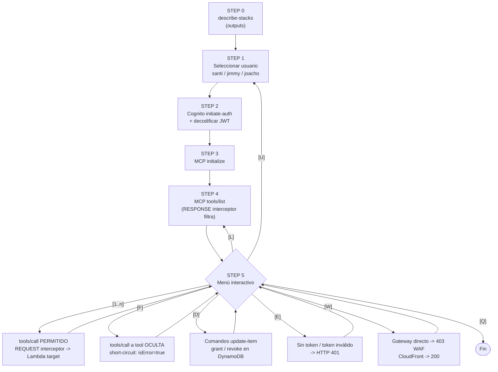

> 💡 Flujo recomendado en una demo: entrar como `jimmy` → mostrar el JWT → `tools/list` (3 tools, canales oculta) → ejecutar `consulta_saldo` → `[F]` forzar `consulta_canales` (DENY con mensaje) → `[D]` otorgar canales en DynamoDB → `[L]` re-listar (aparecen 4 tools sin redeploy) → `[W]` origin cloaking.

### 11.1 Script E2E automatizado (el mismo que validó el despliegue)

```bash
# Valida TODO: 3 usuarios x (list + call permitido + call denegado) + errores
# + ORIGIN CLOAKING (directa al Gateway = bloqueada vs CloudFront = OK):
python3 scripts/validate_fgac.py                     # custom domain + test WAF (default)
python3 scripts/validate_fgac.py --skip-waf-test     # sin el test de origin cloaking
# Nota: '--url-mode gateway' fallara a proposito (el WAF bloquea el acceso directo)
```

### 11.2 curl manual

```bash
DOMAIN="https://santi-bank-fine-access.cb.events.genai.aws.dev/mcp"
TOKEN=$(aws cognito-idp initiate-auth --region us-east-1 \
  --auth-flow USER_PASSWORD_AUTH --client-id 4ilvj9e26ovcv37g152tranglc \
  --auth-parameters USERNAME=joacho,PASSWORD=Testing123. \
  --query "AuthenticationResult.AccessToken" --output text)

# tools/list (joacho -> 2 tools)
curl -s -X POST $DOMAIN \
  -H "Content-Type: application/json" \
  -H "Accept: application/json, text/event-stream" \
  -H "Authorization: Bearer $TOKEN" \
  -d '{"jsonrpc":"2.0","id":1,"method":"tools/list","params":{}}'

# tools/call DENEGADO (joacho NO tiene tarjetas)
curl -s -X POST $DOMAIN \
  -H "Content-Type: application/json" \
  -H "Accept: application/json, text/event-stream" \
  -H "Authorization: Bearer $TOKEN" \
  -d '{"jsonrpc":"2.0","id":2,"method":"tools/call","params":{"name":"consulta-tarjetas___consulta_tarjetas","arguments":{"username":"joacho"}}}'
```

---

## 12. DEMOs guiadas con resultados esperados

### DEMO 1 — Filtrado de ListTools por usuario (RESPONSE Interceptor)

| Paso | Acción | Resultado esperado |
|---|---|---|
| 1 | Token de `santi` → `tools/list` | 4 tools |
| 2 | Token de `jimmy` → `tools/list` | 3 tools (SIN `consulta_canales`) |
| 3 | Token de `joacho` → `tools/list` | 2 tools (`consulta_saldo`, `consulta_canales`) |

### DEMO 2 — "La ves pero NO la ejecutas" / petición armada (REQUEST Interceptor)

| Paso | Acción | Resultado esperado |
|---|---|---|
| 1 | Con token de `jimmy`, invocar `consulta-canales___consulta_canales` (aunque NO aparece en su listado) | 🚫 HTTP 200 + `isError: true` + mensaje detallado. **El Lambda target NUNCA se invoca** (verificable en CloudWatch: el log del interceptor muestra "Short-circuiting request!") |
| 2 | Con token de `joacho`, invocar `consulta-tarjetas___consulta_tarjetas` | 🚫 Igual: DENY con mensaje claro |

### DEMO 3 — Permisos dinámicos (sin redeploy) 🔥

| Paso | Acción | Resultado esperado |
|---|---|---|
| 1 | `aws dynamodb update-item` → `USER#jimmy / TOOL#consulta_canales` → `Allowed=true` | - |
| 2 | `tools/list` con token de jimmy | **4 tools** (aparece canales) — inmediato |
| 3 | `tools/call consulta_canales` con jimmy | ✅ Estado de los 5 canales |
| 4 | Revertir a `Allowed=false` | - |
| 5 | `tools/call consulta_canales` con jimmy | 🚫 DENY inmediato |

```bash
# Otorgar:
aws dynamodb update-item --region us-east-1 \
  --table-name santi-bank-fine-grained-access-mapping \
  --key '{"PK":{"S":"USER#jimmy"},"SK":{"S":"TOOL#consulta_canales"}}' \
  --update-expression "SET Allowed = :v" \
  --expression-attribute-values '{":v":{"BOOL":true}}'
# Revocar: igual con {"BOOL":false}
```

### DEMO 4 — Manejo de errores (Hipótesis 2)

| Prueba | Resultado esperado |
|---|---|
| Sin header Authorization | `HTTP 401 · "Missing Bearer token"` |
| Token corrupto | `HTTP 401 · "Invalid Bearer token"` (mensaje DIFERENTE al anterior) |
| Tool permitida pero username inexistente en data | HTTP 200 con error de negocio en el JSON de la tool |

### DEMO 5 — Origin Cloaking: "solo CloudFront puede llegar al Gateway" 🧱

| Paso | Acción | Resultado esperado |
|---|---|---|
| 1 | Obtener token válido de `santi` | Token OK |
| 2 | `POST` DIRECTO al Gateway URL (`*.gateway.bedrock-agentcore...amazonaws.com/mcp`) con ese token | 🚫 `HTTP 403` + `{"error":{"code":-32002,"message":"Forbidden - Request blocked by AWS WAF"}}`, bloqueado ANTES del JWT authorizer |
| 3 | Mismo `POST` directo pero con `-H "X-Origin-Verify: santi-aws"` (o cualquier valor inventado) | 🚫 `HTTP 403`: el SHA-256 de ese valor no coincide con el digest |
| 4 | Misma petición vía `https://santi-bank-fine-access.cb.events.genai.aws.dev/mcp` | ✅ `HTTP 200` + tools (CloudFront inyectó `X-Origin-Verify`) |
| 5 | Mostrar la regla del WAF (lo que ve Ciber) | Solo `SearchString` = base64(SHA-256) + `TextTransformations: SHA256`, nunca el secreto |
| 6 | Revisar el log del WAF | Entradas `ALLOW` (regla `AllowOnlyCloudFrontWithOriginVerifyHeader`) y `BLOCK` (sin header o hash distinto), con `x-origin-verify` = `REDACTED` |

```bash
# Paso 5: la regla del WAF solo expone el digest
WAF_ID=$(aws wafv2 list-web-acls --scope REGIONAL --region us-east-1 \
  --query "WebACLs[?Name=='santi-bank-gateway-waf-dev'].Id" --output text)
aws wafv2 get-web-acl --scope REGIONAL --region us-east-1 --name santi-bank-gateway-waf-dev --id "$WAF_ID" \
  --query "WebACL.Rules[0].Statement.ByteMatchStatement.{SearchString:SearchString,Transform:TextTransformations[0].Type}"

# Paso 6: ver decisiones del WAF en tiempo real (el header sale REDACTED)
aws logs tail aws-waf-logs-santi-bank-gateway-dev --region us-east-1 --follow
```

### DEMO 6 — Observabilidad (LOGGING SIGNIFICATIVO)

```bash
# Ver la decisión FGAC en tiempo real (ALLOW/DENY, tools removidas, short-circuits):
aws logs tail /aws/lambda/santi-bank-fgac-interceptor-dev --region us-east-1 --follow

# Logs de las tools:
aws logs tail /aws/lambda/santi-bank-consulta-canales-dev --region us-east-1 --follow
```

Ejemplo real del log del interceptor durante un DENY:

```text
[FGAC][REQUEST] MCP method: 'tools/call' | request id: 2
[FGAC][REQUEST] tools/call requested tool: 'consulta-canales___consulta_canales' (base: 'consulta_canales')
[FGAC][DDB] ALLOWED tools for 'jimmy': ['consulta_preferencias', 'consulta_saldo', 'consulta_tarjetas']
[FGAC][REQUEST] DENY - user 'jimmy' tried to execute tool 'consulta_canales' WITHOUT permission. Short-circuiting request!
```

---

## 13. Resultados de la validación E2E (2026-07-26) ✅

### 13.1 🔐 Validación del WAF con SHA-256 (2026-11-19)

Despliegue en 3 pasos sobre el stack vivo (migración a secreto aleatorio, rotación `v2`, cierre de la ventana de rotación) con un monitor llamando `tools/list` por el custom domain cada ~3.5 s:

| Validación | Resultado |
|---|:---:|
| `scripts/validate_fgac.py` (FGAC + errores + 5 checks de config SHA-256 + 6 checks de origin cloaking) | ✅ **21/21 PASS** |
| `GetWebACL`: la regla solo muestra `SearchString` = base64(SHA-256) + transformation `SHA256`; el secreto no aparece ni plano ni en base64 | ✅ |
| Directo al Gateway: sin header / header aleatorio / `santi-aws` / secreto rotado (`AWSPREVIOUS`) → `403 -32002` | ✅ |
| Directo al Gateway con el header correcto → `200` + 4 tools (el WAF calcula `SHA256(header)` y compara) | ✅ |
| Custom domain (CloudFront) → `200` + tools en los 3 pasos | ✅ |
| Monitor, migración inicial SIN espera de propagación | ⚠️ 61 muestras, **1 × 403** (ver 7.3.2) |
| Monitor, rotación `v2` CON `WafPropagationWait` (60 s) | ✅ **66/66 HTTP 200** |
| Monitor, paso 2 (`origin_verify_accept_previous_secret: false`) | ✅ **31/31 HTTP 200** |
| Logs del WAF (8 min, 164 registros): `x-origin-verify` = `REDACTED` en 162/162 | ✅ |
| Logs del interceptor: 316 ocurrencias `***REDACTED***`, ningún secreto en claro | ✅ |
| `cdk diff` después del despliegue → `There were no differences` | ✅ |

> 📝 Nota honesta: el único 403 de la migración inicial lo evaluó un host del WAF con la configuración vieja (sin data protection), así que esa línea de log contiene el valor de ese momento en claro. Ese valor se rotó (`v2`) y hoy el WAF lo rechaza (check "secreto rotado → BLOQUEADO"). Desde la configuración nueva, todos los logs salen redactados.

### 13.2 Validación original (2026-07-26)

Validación inicial (pre-WAF) contra Gateway URL directo + custom domain: **20/20 PASS**. Validación final (con **origin cloaking** activo, vía custom domain + test WAF): **12/12 PASS** con el script + **47/47 assertions** con Postman/newman.

| Validación | Resultado |
|---|:---:|
| `santi` tools/list → 4 tools | ✅ |
| `jimmy` tools/list → 3 tools (sin `consulta_canales`) | ✅ |
| `joacho` tools/list → 2 tools (sin tarjetas/preferencias) | ✅ |
| tools/call permitida (cada usuario) → data real desde DynamoDB | ✅ |
| `jimmy` tools/call FORJADA a `consulta_canales` → bloqueada por REQUEST interceptor (short-circuit) | ✅ |
| `joacho` tools/call FORJADA a `consulta_tarjetas` → bloqueada con mensaje claro | ✅ |
| Token vacío → `401 "Missing Bearer token"` | ✅ |
| Token inválido → `401 "Invalid Bearer token"` (diferenciado por ExceptionLevel DEBUG) | ✅ |
| Revocación/otorgamiento DINÁMICO vía DynamoDB (sin redeploy) | ✅ |
| mcp-inspector CLI (Streamable HTTP + Bearer) vía custom domain | ✅ |
| **Origin cloaking**: invocación DIRECTA al Gateway URL con JWT válido → `403 {"error":{"code":-32002,"message":"Forbidden - Request blocked by AWS WAF"}}` | ✅ |
| **Origin cloaking**: misma petición vía CloudFront (header `X-Origin-Verify` inyectado) → `200` + tools | ✅ |
| WAF logging: decisiones ALLOW/BLOCK visibles en `aws-waf-logs-santi-bank-gateway-dev` (con regla terminante) | ✅ |

---

## 14. Estructura del proyecto

```text
├── README.md                          # Este documento
├── LICENSE                            # Apache License 2.0
├── .gitignore
├── assets/
│   ├── santi-bank-fgac-e2e.drawio / .png              # Arquitectura E2E (FGAC + origin cloaking SHA-256)
│   └── santi-bank-origin-verify-sha256.drawio / .png  # 🔐 Flujo SHA-256: deploy time, runtime, visibilidad y rotación
├── backend/lambdas/
│   ├── consulta_saldo/handler.py          # Tool: saldo de un usuario (users-data)
│   ├── consulta_tarjetas/handler.py       # Tool: tarjetas de un usuario (users-data)
│   ├── consulta_canales/handler.py        # Tool: estado de TODOS los canales (channels-data)
│   ├── consulta_preferencias/handler.py   # Tool: preferencias app de un usuario (users-data)
│   ├── fgac_interceptor/handler.py        # 🛡️ Interceptor FGAC (REQUEST + RESPONSE, redacta x-origin-verify en logs)
│   ├── origin_verify_hash/handler.py      # 🔐 Custom Resource: SHA-256 del secreto para el WAF (+ rotación)
│   ├── setup_custom_resource/handler.py   # Custom Resource: users Cognito + seed DynamoDB
│   └── waf_association/handler.py         # 🧱 Custom Resource: WAF <-> Gateway (retries + refresh)
├── infrastructure/
│   ├── cdk.json                       # app_config (dev): nombres, dominio, deny mode, rotación origin-verify
│   ├── pyproject.toml                 # Poetry (.venv en el root del proyecto CDK)
│   ├── Makefile                       # install / synth / diff / deploy / destroy
│   ├── .gitignore
│   └── cdk/
│       ├── app.py                     # Entry point CDK (DEPLOYMENT_ENVIRONMENT)
│       ├── helpers/add_tags.py        # Tags globales (Owner, Source, Environment...)
│       └── stacks/cdk_santi_bank_stack.py  # Stack completo (métodos organizados)
├── postman/
│   └── santi-bank-fgac.postman_collection.json  # Colección Postman (auto-auth + 47 tests, incl. WAF)
└── scripts/
    ├── demo_fgac.py                   # ⭐ DEMO interactiva paso a paso para clientes (auth -> MCP -> tools)
    └── validate_fgac.py               # Validación E2E (21 checks incl. WAF SHA-256, stdlib + AWS CLI)
```

---

## 15. Limpieza (destroy)

```bash
cd infrastructure
poetry run cdk destroy --all --force
# o: make destroy
```

> Las tablas DynamoDB y el User Pool tienen `RemovalPolicy.DESTROY` en `dev` (se eliminan con el stack). En `prod` la convención del stack cambia a `RETAIN`.

---

## 16. Referencias

| Recurso | Link |
|---|---|
| Notebook oficial FGAC con Data Store (base de este repo) | [agentcore-samples/06-workshops/.../02-fine-grained-access-control-using-data-store.ipynb](https://github.com/awslabs/agentcore-samples/blob/main/06-workshops/02-AgentCore-gateway/09-fine-grained-access-control/02-fine-grained-access-control-using-data-store/02-fine-grained-access-control-using-data-store.ipynb) |
| Docs: Gateway Interceptors (tipos y contratos) | [docs.aws.amazon.com/bedrock-agentcore/.../gateway-interceptors-types](https://docs.aws.amazon.com/bedrock-agentcore/latest/devguide/gateway-interceptors-types.html) |
| Docs: Configuración de interceptores (`passRequestHeaders`) | [docs.aws.amazon.com/bedrock-agentcore/.../gateway-interceptors-configuration](https://docs.aws.amazon.com/bedrock-agentcore/latest/devguide/gateway-interceptors-configuration.html) |
| Docs: Protecting your gateway with AWS WAF (asociación, failure modes, métricas) | [docs.aws.amazon.com/bedrock-agentcore/.../gateway-waf](https://docs.aws.amazon.com/bedrock-agentcore/latest/devguide/gateway-waf.html) |
| Docs: AWS WAF text transformations (`SHA256`, `MD5`) | [docs.aws.amazon.com/waf/.../waf-rule-statement-transformation](https://docs.aws.amazon.com/waf/latest/developerguide/waf-rule-statement-transformation.html) |
| Docs: AWS WAF data protection (`SUBSTITUTION` / `HASH` en logs y sampled requests) | [docs.aws.amazon.com/waf/.../API_DataProtection](https://docs.aws.amazon.com/waf/latest/APIReference/API_DataProtection.html) |
| Docs: CloudFormation dynamic references a Secrets Manager (`version-id`) | [docs.aws.amazon.com/AWSCloudFormation/.../dynamic-references-secretsmanager](https://docs.aws.amazon.com/AWSCloudFormation/latest/UserGuide/dynamic-references-secretsmanager.html) |
| Docs: Resource-based policies para AgentCore (Gateway + `aws:SourceVpce`) | [docs.aws.amazon.com/bedrock-agentcore/.../resource-based-policies](https://docs.aws.amazon.com/bedrock-agentcore/latest/devguide/resource-based-policies.html) |
| Docs: PrivateLink / VPC endpoints para AgentCore (incl. endpoint dedicado de Gateway) | [docs.aws.amazon.com/bedrock-agentcore/.../vpc-interface-endpoints](https://docs.aws.amazon.com/bedrock-agentcore/latest/devguide/vpc-interface-endpoints.html) |
| Blog: Limit access to your origins using the AWS-managed prefix list for CloudFront | [aws.amazon.com/blogs/networking-and-content-delivery/...](https://aws.amazon.com/blogs/networking-and-content-delivery/limit-access-to-your-origins-using-the-aws-managed-prefix-list-for-amazon-cloudfront/) |
| CDK L2: `aws_bedrockagentcore` (Gateway, LambdaInterceptor, Targets) | [docs.aws.amazon.com/cdk/api/v2/docs/aws-cdk-lib.aws_bedrockagentcore-readme](https://docs.aws.amazon.com/cdk/api/v2/docs/aws-cdk-lib.aws_bedrockagentcore-readme.html) |
| MCP Inspector | [github.com/modelcontextprotocol/inspector](https://github.com/modelcontextprotocol/inspector) |

## Usuarios demo (Cognito)

| Usuario | Password | Notas |
|---|---|---|
| `santi` | `Testing123.` | Acceso total (4 tools) |
| `jimmy` | `Testing123.` | Sin `consulta_canales` |
| `joacho` | `Testing123.` | Sin tarjetas ni preferencias |

> ⚠️ Contraseñas de DEMO (requerimiento explícito del escenario). El User Pool **NO permite auto-registro** y el App Client no tiene secret (cliente público solo para pruebas).

# LICENSE

Licensed under the **Apache License, Version 2.0** — see the [LICENSE](./LICENSE) file for details.

Copyright 2026 Santiago Garcia Arango
